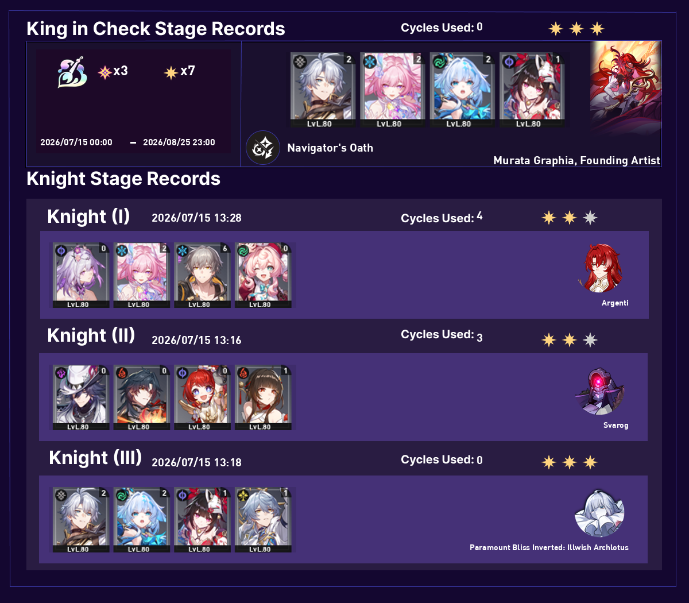
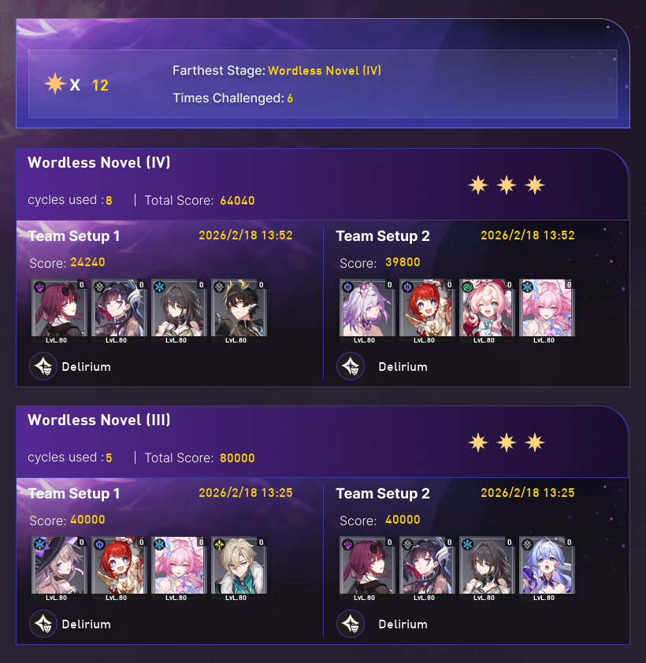
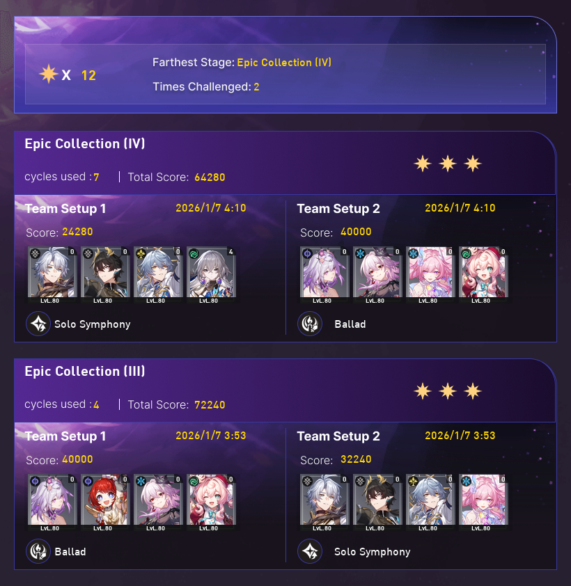

# Honkai Star Rail Cards

A Python library to generate beautiful battle cards for Honkai Star Rail .

## Features

- Render player anomaly cards
- Generate Pure Fiction (PF) stats cards
- Create Memory of Chaos (MOC) cards
- Generate Apocalyptic Shadow (AS) cards
- Clean, type-hinted interface

## Installation

### From PyPI (coming soon)
```bash
pip install hsr-cards
```

### From source
```bash
git clone https://github.com/MR-LORD-REX/hsr-cards.git
cd hsr-cards
pip install -e .
```

## Quick Start

```python
from hsr_cards import HonkaiStarrail
import asyncio
import os
from dotenv import load_dotenv

load_dotenv()

async def test():
    try:
        os.makedirs("Cards", exist_ok=True)
        async with HonkaiStarrail("800556377") as client:
            img=await client.anomaly()
            img.save(f"Cards/Anomaly.png")
            print(f"saved Cards/Anomaly.png")
            
            for i in range(1,3):
                img=await client.PF(schedule_type=str(i))
                img.save(f"Cards/PF_{i}.png")
                print(f"saved Cards/PF_{i}.png")
                
                img=await client.MOC(schedule_type=str(i))
                img.save(f"Cards/MOC_{i}.png")
                print(f"saved Cards/MOC_{i}.png")
                
                img=await client.shadow(schedule_type=str(i))
                img.save(f"Cards/AS_{i}.png")
                print(f"saved Cards/AS_{i}.png")
                
    except Exception as e:
        print(f"Error during test: {e}")
        pass

asyncio.run(test())
```

## Preview

Below are some example cards generated by this library.

### Anomaly


### Pure Fiction (PF)
 

### Memory of Chaos (MOC)
 

### Apocalyptic Shadow (AS)
 

## Nanoka Data SDK

`hsr_cards.nanoka` is an async, cache-first SDK for the HSR data published at
[hsr.nanoka.cc](https://hsr.nanoka.cc/). It downloads the catalogs, every localized
detail document, and all referenced icons on first use, then serves subsequent calls
from `.nanoka_cache/` in the current working directory.

```python
import asyncio
from hsr_cards.nanoka import NanokaClient, Locale


async def main():
    async with NanokaClient(language=Locale.EN) as client:
        await client.initialize()                  # first run: ~200 MB of icons + JSON
        character = await client.get_character(name="Astra Yao")
        latest = await client.get_latest_character(include_beta=True)
        boss = await client.get_live_boss("PF")
        next_pf = await client.get_next_boss("pure fiction")
        print(character.display_name(), character.element, character.path)
        print(latest.id, boss.boss_names, next_pf.boss_names)

        builds = await client.get_versions()       # published builds + live server/beta
        await client.update_assets(version=builds.latest)
        await client.clear_cache(version=builds.live_server)


asyncio.run(main())
```


- Cache layout: `.nanoka_cache/<version>/<locale>/{data,assets}/manifest.json`, plus
  `.nanoka_cache/manifest.json` for the published version list. Pass `cache_dir=` to
  relocate the root. `update_assets(force=True)` revalidates the active build;
  `update_assets(version="4.7.51")` switches to and refreshes one published build.
  `clear_cache(version="4.7.51")` removes that version; `clear_cache()` clears all
  versions and the global manifest.
- `get_versions(refresh=False)` returns a `NanokaVersions` model with `versions`
  (every published build), `live_server` (for example `4.7`), `live_beta` (the
  newest patch build, for example `4.7.51`), and `latest`. Pass `refresh=True` to
  bypass the cached global manifest.
- Versions resolve through `static.nanoka.cc/manifest.json`; pass `version="4.7.51"`
  (or another published build) to pin one.
- Locales: `en`, `zh`, `ja`, `ko` (plus aliases such as `en-us`, `zh-cn`, `jp`, `kr`).
  `display_name(locale=...)` and `boss_names_for(locale=...)` switch per call, with
  English fallback when a localized name is `null`.
- Endgame aliases: `maze` (Forgotten Hall / Memory of Chaos), `maze_extra`
  (Pure Fiction / `PF`), `maze_boss` (Apocalyptic Shadow / `AS`), and `maze_peak`
  (Anomaly Arbitration). Each accepts common aliases; `get_current_endgame`,
  `get_next_endgame`, `get_live_boss`, and `get_next_boss` return schedule and
  boss/stage data ready for card generation.
- Set `include_assets=False` for JSON-only caches. Without a preceding full
  `initialize()`, `character_assets()` lazy-downloads the icons it needs.

## Character Cards

The Nanoka renderer is available from the package root. Character identifiers may be a
numeric id or a published name. Omit `version` for the newest build, pass one version for
a single-version card, or pass `(from_version, to_version)` for an inline comparison.

```python
import asyncio
from hsr_cards import get_character_info, get_character_skills


async def main():
    info = await get_character_info("Mortenax Blade")
    skills = await get_character_skills(1415, version="4.7.51")
    compare_info = await get_character_info(1512, version=("4.6", "4.7.51"))
    compare_skills = await get_character_skills(
        1512, version=("4.6", "4.7.51"), locale="ja"
    )
    info.save("info.png")
    skills.save("skills.png")
    compare_info.save("info-compare.png")
    compare_skills.save("skills-compare.png")


asyncio.run(main())
```

Both functions accept `locale`, `cache_dir`, `proxy`, `rendered_cache_dir`, and
`use_rendered_cache` keyword arguments. Info cards are 1080x1440. Skills sheets are
1920 px wide and grow vertically as the kit requires; a long kit can be taller than
3188 px. Changed blocks are tinted, removed text is struck through, and added text is
highlighted for comparisons.

`get_character_info()` returns an `InfoCardResult`; `get_character_skills()` returns a
`SkillsCardResult`. Both expose `.image` and delegate `.save()` to the PIL image.
`SkillsCardResult` also exposes:

- `.tables` - one 2D `list[list[str]]` per skill, including the `A`/`B` column headers;
- `.table_models` - labeled `SkillTable` objects (`label`, `table_id`, `rows`);
- `.dropdowns` - label -> table index for building rich messages;
- `.sections` - labeled skill, eidolon, and material key/value data;
- `.to_json_dict()` - a JSON-serializable payload of the four fields above.

For comparison skills, changed table cells read `old -> new` (for example
`100% -> 120%`), while descriptions keep their `(A)`/`(B)` column references.

Rendered non-player cards are cached in `.hsr_cards_rendered/` using
`{character}_{card_type}_{version}.png`; comparisons use both versions joined by `--`.
Pass `use_rendered_cache=False` to skip writing, or `force_refresh=True` to rerender
even when a cached file exists.

### Rendering every character

`render_all_info()` and `render_all_skills()` accept the same `version`, `locale`,
`cache_dir`, `proxy`, `rendered_cache_dir`, and `use_rendered_cache` arguments as the
single-character functions, plus:

- `concurrency=4` - the maximum number of characters rendering at once;
- `include_beta=True` - include unreleased Nanoka characters when listing the catalog;
- `identifiers=[...]` - render this explicit subset instead of the whole catalog.

They always rerender cards (an existing `.hsr_cards_rendered/` file is replaced) and
return a `BatchRenderResult`. A failing character is captured in that character's
`BatchCardResult.error` and never cancels the others:

```python
from hsr_cards import render_all_info, render_all_skills

batch = await render_all_skills(("4.6.51", "4.6.54"), concurrency=6)
for item in batch.succeeded:
    print(item.identifier, item.image.size)
for identifier, error in batch.errors.items():
    print("failed", identifier, error)
```

`BatchRenderResult` exposes `.items`, `.succeeded`, `.failed`, `.errors`, and `.images`.
`HonkaiStarrail.render_all_info(...)` and `.render_all_skills(...)` delegate to the same
functions.

## Requirements

- Python 3.10+
- aiohttp
- Pillow (PIL)
- python-dotenv
- asyncio

## API Reference

### `HonkaiStarrail(uid)`

Main client class for generating cards.

**Parameters:**
- `uid` (int | str): Your Honkai Star Rail UID

**Methods:**
- `anomaly()` -> `Image`: Generate an Anomaly card
- `PF(schedule_type)` -> `Image`: Generate a Pure Fiction card
- `MOC(schedule_type)` -> `Image`: Generate a Memory of Chaos card
- `shadow(schedule_type)` -> `Image`: Generate an Apocalyptic Shadow card
- `banners()` -> `Image`: Generate the current banner card
- `events()` -> `Image`: Generate the current events card
- `endgame()` -> `Image`: Generate the current endgame card
- `notes(raw=False)` -> `Image | (Image, NotesData)`: Generate a notes card
- `get_character_info(identifier, version=None, ...)` -> `InfoCardResult`: Generate a Nanoka info card
- `get_character_skills(identifier, version=None, ...)` -> `SkillsCardResult`: Generate a Nanoka skills card

All methods are async. Player methods return PIL images; Nanoka card methods return the
result objects described above.

## Environment Variables

Create a `.env` file in your project root (see `.env_example`):

```
ltoken_v2=v2_CAISdKm9p8FxQ3sZ4gT0RJlkfFn3NbX7tCmmE9ff0ZqjKaB2xPkHYqThZsFQPP5is4NCd2Rjc19vdmVyc2Vh.GxGYbRBBBBBD.MVRCIDFy85cHYgYnvbC4tLpI8wZx0NKq0nq5SKz6o9cE1h_hCjBq2igWd0n4ZBU1rSI52elPNjsgFHz2IRrKLbuI8O7lB
ltuid_v2=242012003
```

## License

MIT License - see LICENSE file for details

## Contributing

Contributions are welcome! Please feel free to submit a Pull Request.

## Disclaimer

This library is not affiliated with or endorsed by HoYoverse. Use at your own risk and in compliance with the game's Terms of Service.
