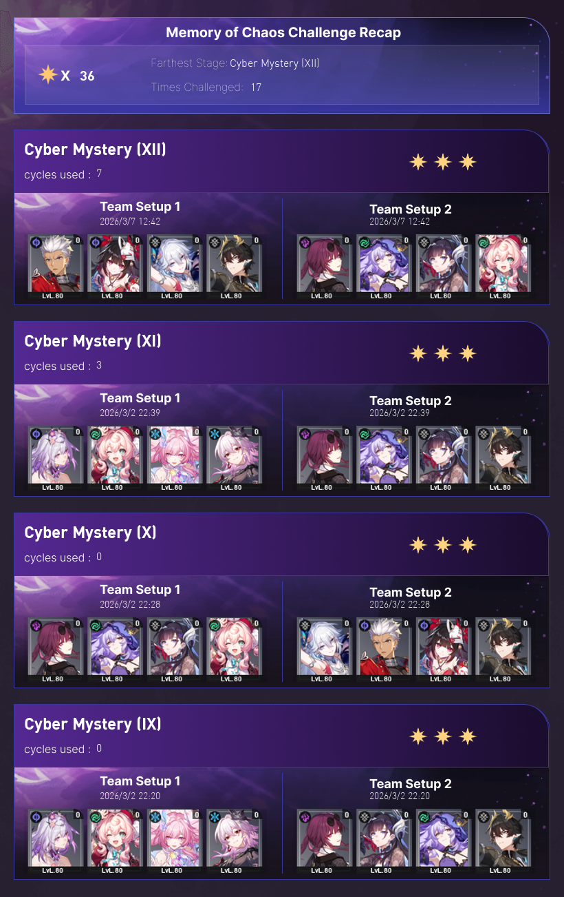
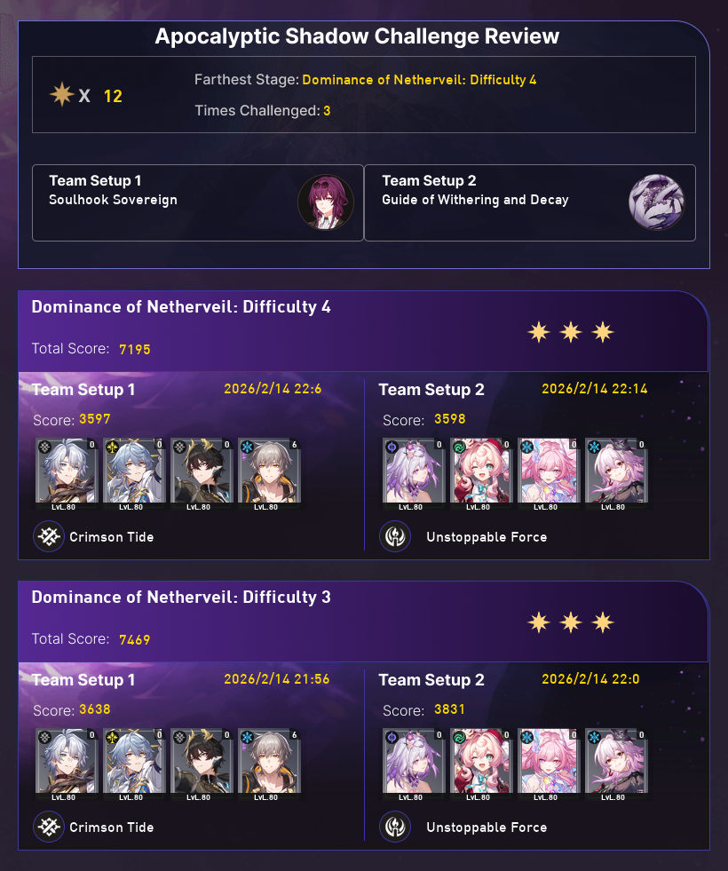

# Honkai Star Rail Cards

A Python library to generate beautiful battle cards for Honkai Star Rail .

## Features

- Render player anomaly cards
- Generate Pure Fiction (PF) stats cards
- Create Memory of Chaos (MOC) cards
- Generate Apocalyptic Shadow (AS) cards
- Clean, type-hinted interface

## Installation

### From PyPI (coming soon)

```bash
pip install hsr-cards
```

### From source

```bash
git clone https://github.com/MR-LORD-REX/hsr-cards.git
cd hsr-cards
pip install -e .
```

## Quick Start

```python
from hsr_cards import HonkaiStarrail
import asyncio
import os
from dotenv import load_dotenv

load_dotenv()

async def test():
    try:
        os.makedirs("Cards", exist_ok=True)
        async with HonkaiStarrail("800556377") as client:
            img=await client.anomaly()
            img.save(f"Cards/Anomaly.png")
            print(f"saved Cards/Anomaly.png")
          
            for i in range(1,3):
                img=await client.PF(schedule_type=str(i))
                img.save(f"Cards/PF_{i}.png")
                print(f"saved Cards/PF_{i}.png")
              
                img=await client.MOC(schedule_type=str(i))
                img.save(f"Cards/MOC_{i}.png")
                print(f"saved Cards/MOC_{i}.png")
              
                img=await client.shadow(schedule_type=str(i))
                img.save(f"Cards/AS_{i}.png")
                print(f"saved Cards/AS_{i}.png")
              
    except Exception as e:
        print(f"Error during test: {e}")
        pass

asyncio.run(test())
```

## Preview

Below are some example cards generated by this library.

### Anomaly


### Pure Fiction (PF)

 

### Memory of Chaos (MOC)

 

### Apocalyptic Shadow (AS)

 

## Client and provider layout

The main facade and provider clients now have independent responsibilities:

- `hsr_cards.clients.main.HonkaiStarrail` delegates player queries and card operations.
- `hsr_cards.clients.hoyolab.HoYoLABClient` validates player API responses.
- `hsr_cards.clients.nanoka.NanokaClient` resolves Nanoka catalogs and domain objects.
- `hsr_cards.clients.prydwen.PrydwenClient` exposes Prydwen queries and the existing build pipeline.
- `hsr_cards.providers.{hoyolab,nanoka,prydwen}` owns provider API access, schemas, and parsing. Nanoka's raw API is `NanokaAPIClient`; Prydwen's is `PrydwenAPIClient`.
- `hsr_cards.services` loads data, prepares render models, and manages rendered caches. Renderer modules draw resolved data.

Existing package-root imports and the `hsr_cards.client`, `hsr_cards.nanoka`,
and `hsr_cards.prydwen` import paths remain supported. Importing public APIs
creates no directories, loads no `.env` file, and opens no sessions.

`HonkaiStarrail()` supports non-player operations without a UID. Player methods
require a UID. Its optional `hoyolab_client`, `nanoka_client`, and `prydwen_client`
arguments borrow existing clients; closing the facade closes only clients it
created. Provider clients can also be used independently.

```python
from hsr_cards import HonkaiStarrail, NanokaClient, get_current_endgame_card

async def cards():
    async with HonkaiStarrail() as client:
        info = await client.get_character_info(1507, version="4.7.51")
        info.save("character-info.png")

    async with NanokaClient(language="en", include_assets=False) as nanoka:
        await nanoka.initialize()
        pf = await get_current_endgame_card("PF", client=nanoka)
        pf.cards[-1].save("pf-floor4.png")
```

Character drawing is split into `renderer/nanoka/info` and
`renderer/nanoka/skills`; Nanoka floor drawing lives in
`renderer/nanoka/endgame`. Shared locale, build-selection, filename, text, and
image helpers retain the existing cache paths and card output.

## Nanoka Data SDK

`hsr_cards.nanoka` is an async, cache-first SDK for the HSR data published at
[hsr.nanoka.cc](https://hsr.nanoka.cc/). It downloads the catalogs, every localized
detail document, and all referenced icons on first use, then serves subsequent calls
from `.nanoka_cache/` in the current working directory.

```python
import asyncio
from hsr_cards.nanoka import NanokaClient, Locale


async def main():
    async with NanokaClient(language=Locale.EN) as client:
        await client.initialize()                  # first run: ~200 MB of icons + JSON
        character = await client.get_character(name="Astra Yao")
        latest = await client.get_latest_character(include_beta=True)
        boss = await client.get_live_boss("PF")
        next_pf = await client.get_next_boss("pure fiction")
        print(character.display_name(), character.element, character.path)
        print(latest.id, boss.boss_names, next_pf.boss_names)

        builds = await client.get_versions()       # published builds + live server/beta
        await client.update_assets(version=builds.latest)
        await client.clear_cache(version=builds.live_server)


asyncio.run(main())
```

- Cache layout: `.nanoka_cache/<version>/<locale>/{data,assets}/manifest.json`, plus
  `.nanoka_cache/manifest.json` for the published version list. Pass `cache_dir=` to
  relocate the root. `update_assets(force=True)` revalidates the active build;
  `update_assets(version="4.7.51")` switches to and refreshes one published build.
  `clear_cache(version="4.7.51")` removes that version; `clear_cache()` clears all
  versions and the global manifest.
- `get_versions(refresh=False)` returns a `NanokaVersions` model with `versions`
  (every published build), `live_server` (for example `4.7`), `live_beta` (the
  newest patch build, for example `4.7.51`), and `latest`. Pass `refresh=True` to
  bypass the cached global manifest.
- Versions resolve through `static.nanoka.cc/manifest.json`; pass `version="4.7.51"`
  (or another published build) to pin one.
- Locales: `en`, `zh`, `ja`, `ko` (plus aliases such as `en-us`, `zh-cn`, `jp`, `kr`).
  `display_name(locale=...)` and `boss_names_for(locale=...)` switch per call, with
  English fallback when a localized name is `null`.
- Endgame aliases: `maze` (Forgotten Hall / Memory of Chaos), `maze_extra`
  (Pure Fiction / `PF`), `maze_boss` (Apocalyptic Shadow / `AS`), and `maze_peak`
  (Anomaly Arbitration). Each accepts common aliases; `get_current_endgame`,
  `get_next_endgame`, `get_live_boss`, and `get_next_boss` return schedule and
  boss/stage data ready for card generation.
- Set `include_assets=False` for JSON-only caches. Without a preceding full
  `initialize()`, `character_assets()` lazy-downloads the icons it needs.

## Endgame floor cards

Generate Nanoka info cards for Memory of Chaos (`MOC`), Pure Fiction (`PF`),
and Apocalyptic Shadow (`AS`) without a player UID or HoYoLAB cookies:

```python
from hsr_cards import get_current_endgame_card, get_next_endgame_card

async def endgame_cards():
    current = await get_current_endgame_card("PF")  # Floors 3 and 4
    upcoming = await get_next_endgame_card("AS", floors=4)
    for card in current.cards:
        card.save(f"PF-{current.season_id}-{card.floor}.png")
    upcoming.cards[0].save("AS-next-floor4.png")
```

Both functions are also available as `HonkaiStarrail` methods. MOC defaults to
floors 11 and 12; PF and AS default to floors 3 and 4. Pass an integer or a sequence
of floor numbers to select floors. Floor 4 includes its continuation: PF's third
node and AS's Starward mode. PF uses complete wave rosters and counts; AS includes
season and boss effects. Both show per-node elements, HP bars, and corrosion.

The result exposes `game_mode`, `season_id`, `season_name`, `version`, `cards`,
`images`, `begins_at`, `ends_at`, and `is_live`. Each floor card exposes `image`,
`floor`, `stage_id`, `name`, `cache_path`, and `save()`.

`get_next_endgame_card(..., look_ahead=1)` returns one result. A larger positive
integer or `"max"` returns a list in live-date order, skipping unpublished stage
data. Seasons without live dates follow dated seasons, show `UNSCHEDULED`, and
expose `None` for their live dates. Deployment/test dates do not determine live
status. A missing current season or single upcoming result raises `ValueError`;
list requests return an empty list when nothing is available.

Common options are `locale`, `cache_dir`, `proxy`, `rendered_cache_dir`,
`use_rendered_cache`, and `force_refresh`. Rendered caches include the schedule
status so an upcoming badge is refreshed when the season goes live.

Both functions and their facade methods annotate `game_mode` with
`Literal["MOC", "PF", "AS", "AA"]` for editor suggestions. They still accept
lowercase mode strings at runtime. An optional initialized `client=NanokaClient(...)`
is reused and remains caller-owned; its language determines localized render-cache
filenames. Otherwise each operation creates, reuses, and closes one client across
all requested floors and seasons.

AA (Anomaly Arbitration) floor cards are deferred; both entry points raise
`NotImplementedError` for `"AA"`.

## Character Cards

The Nanoka renderer is available from the package root. Character identifiers may be a
numeric id or a published name. Omit `version` for the newest build, pass one version for
a single-version card, or pass `(from_version, to_version)` for an inline comparison.

```python
import asyncio
from hsr_cards import get_character_info, get_character_skills


async def main():
    info = await get_character_info("Mortenax Blade")
    skills = await get_character_skills(1415, version="4.7.51")
    compare_info = await get_character_info(1512, version=("4.6", "4.7.51"))
    compare_skills = await get_character_skills(
        1512, version=("4.6", "4.7.51"), locale="ja"
    )
    info.save("info.png")
    skills.save("skills.png")
    compare_info.save("info-compare.png")
    compare_skills.save("skills-compare.png")


asyncio.run(main())
```

Both functions accept `locale`, `cache_dir`, `proxy`, `rendered_cache_dir`, and
`use_rendered_cache` keyword arguments. Info cards are 1080x1440. Skills sheets are
1920 px wide and grow vertically as the kit requires; a long kit can be taller than
3188 px. Changed blocks are tinted, removed text is struck through, and added text is
highlighted for comparisons.

`get_character_info()` returns an `InfoCardResult`; `get_character_skills()` returns a
`SkillsCardResult`. Both expose `.image` and delegate `.save()` to the PIL image.
`SkillsCardResult` also exposes:

- `.tables` - one 2D `list[list[str]]` per skill, including the `A`/`B` column headers;
- `.table_models` - labeled `SkillTable` objects (`label`, `table_id`, `rows`);
- `.dropdowns` - label -> table index for building rich messages;
- `.sections` - labeled skill, eidolon, and material key/value data;
- `.to_json_dict()` - a JSON-serializable payload of the four fields above.

For comparison skills, changed table cells read `old -> new` (for example
`100% -> 120%`), while descriptions keep their `(A)`/`(B)` column references.

Rendered non-player cards are cached in `.hsr_cards_rendered/` using
`{character}_{card_type}_{version}.png`; comparisons use both versions joined by `--`.
Pass `use_rendered_cache=False` to skip writing, or `force_refresh=True` to rerender
even when a cached file exists.

### Rendering every character

`render_all_info()` and `render_all_skills()` accept the same `version`, `locale`,
`cache_dir`, `proxy`, `rendered_cache_dir`, and `use_rendered_cache` arguments as the
single-character functions, plus:

- `concurrency=4` - the maximum number of characters rendering at once;
- `include_beta=True` - include unreleased Nanoka characters when listing the catalog;
- `identifiers=[...]` - render this explicit subset instead of the whole catalog.

They always rerender cards (an existing `.hsr_cards_rendered/` file is replaced) and
return a `BatchRenderResult`. A failing character is captured in that character's
`BatchCardResult.error` and never cancels the others:

```python
from hsr_cards import render_all_info, render_all_skills

batch = await render_all_skills(("4.6.51", "4.6.54"), concurrency=6)
for item in batch.succeeded:
    print(item.identifier, item.image.size)
for identifier, error in batch.errors.items():
    print("failed", identifier, error)
```

`BatchRenderResult` exposes `.items`, `.succeeded`, `.failed`, `.errors`, and `.images`.
`HonkaiStarrail.render_all_info(...)` and `.render_all_skills(...)` delegate to the same
functions.

## Character Build Cards

`character_build()` is available on both `NanokaClient` and `HonkaiStarrail`.
Identifiers follow Nanoka's rules: numeric id, published name, or catalog filters.
Local id/name lookups read the build metadata without fetching the catalog.

```python
image = await client.character_build("Acheron")  # one clean PIL image
link = await client.character_build(1308, url=True)  # one raw GitHub URL
images = await client.character_build("Acheron", detailed=True)  # list[PIL.Image]
links = await client.character_build(1308, detailed=True, url=True)  # list[str]
```

The default `detailed=False` returns one clean summary. `detailed=True` returns the
annotated summary first, followed by all its condition pages in page order. It never
includes the clean summary. Missing variants return `None`; a detailed image request
also returns `None` if any of its local files are missing. URL requests use metadata
and do not require local PNGs.

Approved cards use this layout:

```text
src/hsr_cards/assets/char_builds/
  metadata.json                         # complete remote-update index
  acheron/
    metadata.json                       # character, source, review, image URLs/hashes
    acheron.png                         # clean summary
    acheron.detailed.png                # annotated summary
    acheron.detailed.conditions-01.png   # exact source conditions; more pages as needed
```

Each character's metadata contains `character_id`, `char_name`, `slug`, `source`,
`source_html_sha256`, `website_last_updated`, `review`, `rendered_at`, and `images`.
Every image entry has `filename`, `detailed`, `raw_url`, `git_url`, `sha256`, and `size`.
The root index maps character ids to these same records. This replaces the previous
flat image layout; no legacy metadata conversion is performed.

`await client.update_builds()` downloads the root index and every listed clean,
detailed, and condition PNG into its character folder, then writes both metadata
copies. It returns the number of downloaded images and preserves local-only entries.
Metadata is published only after all downloads succeed. Generated GitHub links refer
to `main`; those links become reachable after the assets are pushed to that branch.

### Prydwen build pipeline

The former standalone `hsr_prydwen` package is now `hsr_cards.prydwen.builds`.
`PrydwenClient` exposes every CLI operation without requiring a player UID or cookies.
All downloaded pages, parsed JSON, draft previews, render reports, review manifests,
and contact sheets live under the root `.hsr_prydwen/` working directory. Nested
working directories reuse the nearest ancestor's existing `.hsr_prydwen/`.
Use `work_dir=` or CLI `--work-dir` to choose another location.

```python
from hsr_cards import PrydwenClient

builds = PrydwenClient()
await builds.urls()                              # roster -> rawUrls.json
await builds.pull(["acheron"], concurrency=2)    # raw HTML + fetch metadata
parsed = builds.parse(["acheron"])              # resets parsed builds to draft
checks = builds.validate([builds.data_dir / "acheron.json"])
builds.teams(allow_draft=True)                    # data/teams.json

# After reviewing the source JSON and previews:
builds.approve("acheron", reviewer="sora", note="Checked source and cards")
base = builds.card("acheron")                    # exclude_extra=True by default
full = builds.card("acheron", exclude_extra=False)

# Explicit batch operations; failures do not cancel other characters.
approvals = builds.approve_all(reviewer="sora", note="Reviewed batch")
clean_batch = builds.cards()
detailed_batch = builds.cards(exclude_extra=False)
```

Only `urls()` and `pull()` are async. Offline operations are synchronous. `parse()`
and `pull()` return `paths` and `failed`; `pull()` also returns `cached` and `downloaded`.
`validate()` returns per-file `status` and `problems`. `approve_all()` returns `approved`
build models and `failed` file/error records. `cards()` returns `cards`, `skipped`,
`failed`, and `contact_sheets`. Omitting a character list selects all cached builds.
Batch approval still checks every source hash, schema, asset, and validation blocker;
failed builds keep their previous review state.

`card(..., allow_draft=True)` and `cards(..., allow_draft=True)` allow draft previews
without publishing them. Approved renders are automatically copied to
`char_builds/<slug>/` with updated character and root metadata. Rendering a second
variant preserves the first when both refer to the same source hash. A changed source
invalidates older published variants. Canonical source JSON is never modified by
`exclude_extra`: it hides condition references such as `[L3]`/`[A1]`, overflow labels
such as `+1 in JSON`/`+1 groups`, and companion sheets in the clean render.

The same operations are available through the installed `hsr-prydwen` command or
`python -m hsr_cards.prydwen.builds.cli` (using the project's interpreter):

```powershell
& '.\.venv\Scripts\python.exe' -m hsr_cards.prydwen.builds.cli urls
& '.\.venv\Scripts\python.exe' -m hsr_cards.prydwen.builds.cli pull acheron
& '.\.venv\Scripts\python.exe' -m hsr_cards.prydwen.builds.cli parse acheron
& '.\.venv\Scripts\python.exe' -m hsr_cards.prydwen.builds.cli card acheron --allow-draft
& '.\.venv\Scripts\python.exe' -m hsr_cards.prydwen.builds.cli card acheron --allow-draft --detailed
& '.\.venv\Scripts\python.exe' -m hsr_cards.prydwen.builds.cli approve acheron --reviewer sora
& '.\.venv\Scripts\python.exe' -m hsr_cards.prydwen.builds.cli approve-all --reviewer sora
& '.\.venv\Scripts\python.exe' -m hsr_cards.prydwen.builds.cli cards
& '.\.venv\Scripts\python.exe' -m hsr_cards.prydwen.builds.cli cards --no-exclude-extra
```

`approve --all` is equivalent to `approve-all`. The latter also accepts character slugs
for a subset. `card` accepts `data=`/`--data`; `approve` accepts `file=`/`--file`.
Both render methods accept `out=`/`--out` for the working image destination;
approved publication still uses `build_dir`. Clean and detailed variants are rendered
with separate calls, so both remain available.

Client constructor options have matching global CLI flags: `work_dir`, `build_dir`,
`nanoka_cache`, `nanoka_version` (default `4.7.51`), `headed`, `proxy`, `settle_ms`,
`timeout_ms`, `retries`, `chrome`, `transport`, and `refresh`. Use underscores in Python
and hyphens in CLI flags. Global flags precede the subcommand. HTTP is the default;
optional browser support requires `pip install 'hsr-cards[browser]'` and an installed
browser. Parsing/rendering never fetch missing art. The read-only Nanoka index reuses
an existing `.nanoka_cache/` at the root or in `hsr_cards/`; otherwise initialize a
Nanoka cache and pass its directory explicitly. Fonts and fallback property icons
are bundled in `hsr_cards/assets/`.

## Light Cone Info Cards

`get_LC_info()` accepts the same arguments as `get_character_info()`: a numeric id or
published name, optional version (one build or a two-build comparison), `locale`,
`cache_dir`, `proxy`, `rendered_cache_dir`, and `use_rendered_cache`.

```python
from hsr_cards import get_LC_info

info = await get_LC_info("No Shifts on Rainy Days", version="4.7.51")
info.save("light-cone.png")
comparison = await get_LC_info(23065, version=("4.6.51", "4.6.54"))
comparison.save("light-cone-comparison.png")

# The same arguments work on the main client.
info = await client.get_LC_info("A Grounded Ascent")
```

The card fixes stats at level 80 and displays all five superimposition values inline,
in S1/S2/S3/S4/S5 order. For example, Energy reads **6/6.5/7/7.5/8**, while DMG reads
**15/17.25/19.5/21.75/24%**. Unchanging values appear once. Bold gold numbers and cyan
mechanic names stand out against a dark background, with 32 px body text. The artwork,
path, rarity, base stats, and total ascension materials are included; there are no sliders.

Cards are 1080x1440 portrait images, growing vertically when a description needs more
space. The reference "No Shifts on Rainy Days" card is 1080x1464. Version comparisons
strike through removed text and highlight additions in green. Stats and material counts
show their previous values when changed.

The returned `LCInfoCardResult` exposes `.image`, `.light_cone` (name), `.identifier`,
`.version`, `.cache_path`, `.description` (plain text with S1-S5 values), and `.stats`
(level-80 HP/ATK/DEF). It delegates `.save()` and image attributes to its PIL image.
Rendered files use `{name}_lc_info_{version}.png`, with both builds joined by `--` for
comparisons and a locale suffix for non-English cards. The standalone function also
accepts `force_refresh=True`, matching `get_character_info()`.

## Relic Set Info Cards

`get_relic_info()` accepts the same arguments as `get_character_info()`: a numeric set
id or published name, optional version (one build or a two-build comparison), `locale`,
`cache_dir`, `proxy`, `rendered_cache_dir`, and `use_rendered_cache`.

```python
from hsr_cards import get_relic_info

info = await get_relic_info("The Edacious Heretic", version="4.7.51")
info.save("relic-set.png")
planar = await get_relic_info(309)  # Rutilant Arena, newest build.
planar.save("planar-set.png")
comparison = await get_relic_info(330, version=("4.6.51", "4.6.54"))
comparison.save("relic-comparison.png")

# The same arguments work on the main client.
info = await client.get_relic_info("The Edacious Heretic")
```

Each card includes the set icon, individual piece artwork and slot names, and all set
bonuses with bold gold values. Cavern Relic cards start at 1080x1350; Planar Ornament
cards start at 1080x1080. Cards grow vertically for long text and version comparisons.
Comparisons strike through removed text, highlight additions, and retain removed
bonuses and pieces.

The returned `RelicInfoCardResult` exposes `.image`, `.relic_set` (name), `.identifier`,
`.version`, `.cache_path`, `.set_type` (`"cavern"` or `"planar"`), `.effects` (piece count
to resolved description), and `.parts` (`RelicPart` models). It delegates `.save()` and
image attributes to its PIL image. Rendered files use `{name}_relic_info_{version}.png`,
with both builds joined by `--` for comparisons and a locale suffix for non-English
cards. The standalone function also accepts `force_refresh=True`.

## Item Info Cards

`get_item_info()` accepts the same arguments as `get_character_info()`: a numeric item
id or published name, optional version (one build or a two-build comparison), `locale`,
`cache_dir`, `proxy`, `rendered_cache_dir`, and `use_rendered_cache`.

```python
from hsr_cards import get_item_info

info = await get_item_info("Refined Aether", version="4.7.51")
info.save("item.png")
comparison = await get_item_info(241, version=("4.6.51", "4.6.54"))
comparison.save("item-comparison.png")

# The same arguments work on the main client.
info = await client.get_item_info(223)
```

Cards start at 1080x1350 and grow vertically for long descriptions or source lists.
They include artwork, name, rarity, purpose, category, gameplay description, and
acquisition sources. Items without a gameplay description use their background lore.
Numbers use bold gold text. Comparisons highlight additions, strike through removed
text, and retain removed sources; null or blank source descriptions are omitted.

`ItemInfoCardResult` exposes `.image`, `.item` (name), `.identifier`, `.version`,
`.cache_path`, `.description`, `.background` (lore), `.purpose`, `.rarity` (star count),
`.main_type`, `.sub_type`, and `.sources` (localized strings). It delegates `.save()` and
image attributes to its PIL image. Rendered files use `{name}_{id}_item_info_{version}.png`
to distinguish items with identical names, with both versions joined by `--` for
comparisons and a locale suffix for non-English cards. The standalone function also
accepts `force_refresh=True`.

## Prydwen Tier List

Render Prydwen's current HSR tier list in a 1280 px wide image with four role columns,
colored tier bars, character portraits, elements, eidolons, tags, and movement badges.
The height grows to fit every tier. Choose `game_mode="MOC"` (Memory of Chaos, the
default), `"PF"` (Pure Fiction), or `"AS"` (Apocalyptic Shadow). The parser reads each
mode's own rankings, tags, and badges from the data embedded in Prydwen's page.
The source URL, selected mode, and published update date appear on the card.

```python
from hsr_cards import tier_list

# No UID or HoYoLAB cookies needed for the standalone function.
image, data = await tier_list(game_mode="PF", raw=True)
image.save("tier-list.png")
print(data.mode, data.updated)
```

The main client exposes the same renderer:

```python
from hsr_cards import HonkaiStarrail

async with HonkaiStarrail("800556377") as client:
    image = await client.tier_list()  # Defaults to MOC.
    image.save("Cards/TierList-MOC.png")
    (await client.tier_list("PF")).save("Cards/TierList-PF.png")
    image, data = await client.tier_list(game_mode="AS", raw=True)
    image.save("Cards/TierList-AS.png")
```

The default return value is a PIL image; `raw=True` returns `(image, TierListData)`.
Both entry points accept `timeout=30.0` (seconds per request). The standalone function
also accepts `proxy=`; the client method uses the proxy supplied to `HonkaiStarrail`.
Portraits download concurrently and each unique URL is fetched once per render.
Unavailable portraits become named placeholders; page-fetch and parsing errors are raised.

For data only, use `await fetch_tier_list(game_mode="PF")` or
`parse_tier_list(html, game_mode="AS")` from `hsr_cards`.
`TierListData` exposes `.mode`, `.mode_key`, `.updated`, `.roles`, `.groups`, `.tiers`,
and `.source`. Each tier contains ordered `.roles`, each with `.characters` carrying
`.name`, `.slug`, `.icon_url`, `.element`, `.rarity`, `.eidolon`, `.tags`, and `.marks`.
To render data you already parsed, use the renderer directly:

```python
from hsr_cards import parse_tier_list
from hsr_cards.renderer.prydwen import TierListRenderer

data = parse_tier_list(saved_html, game_mode="MOC")
async with TierListRenderer() as renderer:
    image = await renderer.render_tier_list(data)
```

Offline parser, renderer, and client tests run without additional test dependencies:

```powershell
$env:PYTHONPATH = (Resolve-Path src).Path
& '.\.venv\Scripts\python.exe' -m unittest discover -s tests -v
```

## Requirements

- Python 3.10+
- aiohttp
- Pillow (PIL)
- python-dotenv
- cloudscraper
- asyncio

## API Reference

### `HonkaiStarrail(uid=None, cookie=None, proxy=None, ...)`

Main client class for generating cards.

**Parameters:**

- `uid` (int | str | None): Your Honkai Star Rail UID; required for player methods.
- `cookie` (`Cookies | None`): Explicit HoYoLAB credentials for authenticated methods.
- `proxy` (`str | None`): Default proxy for owned provider clients and card operations.
- `hoyolab_client`, `nanoka_client`, `prydwen_client`: Optional caller-owned clients.

**Methods:**

- `anomaly()` -> `Image`: Generate an Anomaly card
- `PF(schedule_type)` -> `Image`: Generate a Pure Fiction card
- `MOC(schedule_type)` -> `Image`: Generate a Memory of Chaos card
- `shadow(schedule_type)` -> `Image`: Generate an Apocalyptic Shadow card
- `banners()` -> `Image`: Generate the current banner card
- `events()` -> `Image`: Generate the current events card
- `endgame()` -> `Image`: Generate the current endgame card
- `currency_war(index=0, raw=False)` -> `CurrencyWarResult`: Render one Currency Wars run
- `notes(raw=False)` -> `Image | (Image, NotesData)`: Generate a notes card
- `character_build(identifier=None, url=False, detailed=False, ...)` -> `Image | str | list[Image] | list[str] | None`: Return a community build card or its raw GitHub URL
- `update_builds()` -> `int`: Refresh bundled community build images from the repository metadata
- `update_nanoka_assets(version=None, force=False)` -> `None`: Refresh the Nanoka cache
- `get_LC_info(identifier, version=None, ...)` -> `LCInfoCardResult`: Generate a level-80 Nanoka Light Cone card with inline S1-S5 values
- `get_relic_info(identifier, version=None, ...)` -> `RelicInfoCardResult`: Generate a Nanoka relic or planar set card with all pieces and set bonuses
- `get_item_info(identifier, version=None, ...)` -> `ItemInfoCardResult`: Generate a Nanoka item card with artwork, description, and acquisition sources
- `get_character_info(identifier, version=None, ...)` -> `InfoCardResult`: Generate a Nanoka info card
- `get_character_skills(identifier, version=None, ...)` -> `SkillsCardResult`: Generate a Nanoka skills card
- `get_current_endgame_card(game_mode="MOC", floors=None, ...)` -> `EndgameCardResult`: Render live MOC/PF/AS floor cards.
- `get_next_endgame_card(game_mode="MOC", floors=None, look_ahead=1, ...)` -> `EndgameCardResult | list[EndgameCardResult]`: Render upcoming floor cards.
- `tier_list(game_mode="MOC", raw=False, timeout=30.0)` -> `Image | (Image, TierListData)`: Render Prydwen's MOC, PF, or AS tier list
- `redeem_codes()` -> `list[RedeemCode]`: Fetch active HSR redeem codes and their rewards from Prydwen

`currency_war()` returns a `CurrencyWarResult` with:

- `.image` - a 720 px wide PNG-ready PIL image of one run (Telegram friendly);
- `.current` - the rendered run index, newest run first;
- `.next()` / `.prev()` - the adjacent run index, or `None` at either end;
- `.all` - every available run index, e.g. `[0, 1, 2]`.

```python
async with HonkaiStarrail("800556377") as client:
    run = await client.currency_war(0)
    run.image.save("Cards/CurrencyWar.png")
    for i in run.all:
        (await client.currency_war(i)).image.save(f"Cards/CurrencyWar_{i}.png")
```

`redeem_codes()` reads Prydwen's active-codes list. Each returned `RedeemCode` is one code
with its rewards:

```python
from hsr_cards import HonkaiStarrail

async with HonkaiStarrail("800556377") as client:
    for redeem in await client.redeem_codes():
        print(redeem.code)
        for reward in redeem.rewards:
            print(" ", reward.name, reward.count, reward.url)
```

`RedeemCode` exposes `.code` and `.rewards`; each `Reward` exposes `.name`, `.count`, and `.url`.

All methods are async. Player methods return PIL images; Nanoka card methods return the
result objects described above.

## Environment Variables

Create a `.env` file in your project root (see `.env_example`):

The package does not load it automatically. Load it in your application and
pass the credentials explicitly:

```python
from dotenv import load_dotenv
import os
from hsr_cards import HonkaiStarrail
from hsr_cards.models.auth import Cookies

load_dotenv()
cookie = Cookies(ltoken_v2=os.environ["ltoken_v2"], ltuid_v2=os.environ["ltuid_v2"])
client = HonkaiStarrail("800556377", cookie=cookie)
```

```
ltoken_v2=v2_CAISdKm9p8FxQ3sZ4gT0RJlkfFn3NbX7tCmmE9ff0Zq
ltuid_v2=2420xxxx
```

## License

MIT License - see LICENSE file for details

## Contributing

Contributions are welcome! Please feel free to submit a Pull Request.

## Disclaimer

This library is not affiliated with or endorsed by HoYoverse. Use at your own risk and in compliance with the game's Terms of Service.
