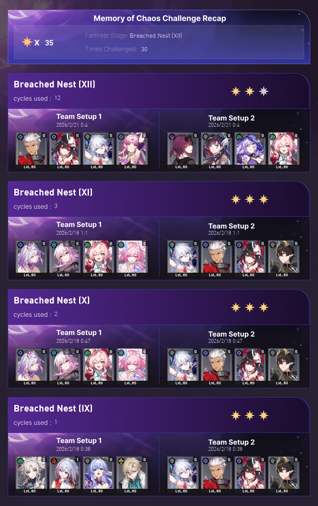
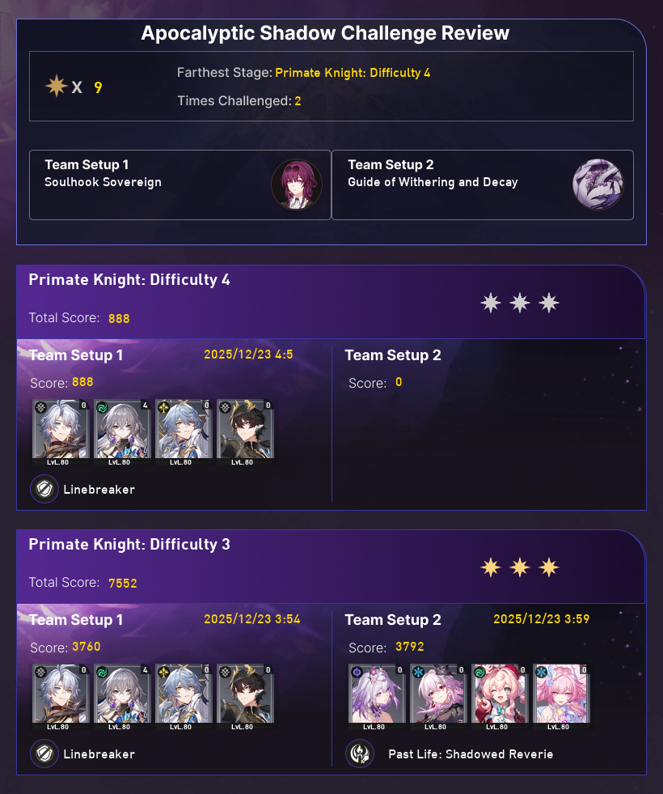

# Honkai Star Rail Cards

A Python library to generate beautiful battle cards for Honkai Star Rail .

## Features

- Render player anomaly cards
- Generate Pure Fiction (PF) stats cards
- Create Memory of Chaos (MOC) cards
- Generate Apocalyptic Shadow (AS) cards
- Clean, type-hinted interface

## Installation

### From PyPI (coming soon)
```bash
pip install hsr-cards
```

### From source
```bash
git clone https://github.com/MR-LORD-REX/hsr-cards.git
cd hsr-cards
pip install -e .
```

## Quick Start

```python
from hsr_cards import HonkaiStarrail
import asyncio
import os
from dotenv import load_dotenv

load_dotenv()

async def test():
    try:
        os.makedirs("Cards", exist_ok=True)
        async with HonkaiStarrail("800556377") as client:
            img=await client.anomaly()
            img.save(f"Cards/Anomaly.png")
            print(f"saved Cards/Anomaly.png")
            
            for i in range(1,3):
                img=await client.PF(schedule_type=str(i))
                img.save(f"Cards/PF_{i}.png")
                print(f"saved Cards/PF_{i}.png")
                
                img=await client.MOC(schedule_type=str(i))
                img.save(f"Cards/MOC_{i}.png")
                print(f"saved Cards/MOC_{i}.png")
                
                img=await client.shadow(schedule_type=str(i))
                img.save(f"Cards/AS_{i}.png")
                print(f"saved Cards/AS_{i}.png")
                
    except Exception as e:
        print(f"Error during test: {e}")
        pass

asyncio.run(test())
```

## Preview

Below are some example cards generated by this library.

### Anomaly


### Pure Fiction (PF)
 

### Memory of Chaos (MOC)
 

### Apocalyptic Shadow (AS)
 

## Nanoka Data SDK

`hsr_cards.nanoka` is an async, cache-first SDK for the HSR data published at
[hsr.nanoka.cc](https://hsr.nanoka.cc/). It downloads the catalogs, every localized
detail document, and all referenced icons on first use, then serves subsequent calls
from `.nanoka_cache/` in the current working directory.

```python
import asyncio
from hsr_cards.nanoka import NanokaClient, Locale


async def main():
    async with NanokaClient(language=Locale.EN) as client:
        await client.initialize()                  # first run: ~200 MB of icons + JSON
        character = await client.get_character(name="Astra Yao")
        latest = await client.get_latest_character(include_beta=True)
        boss = await client.get_live_boss("PF")
        next_pf = await client.get_next_boss("pure fiction")
        print(character.display_name(), character.element, character.path)
        print(latest.id, boss.boss_names, next_pf.boss_names)

        builds = await client.get_versions()       # published builds + live server/beta
        await client.update_assets(version=builds.latest)
        await client.clear_cache(version=builds.live_server)


asyncio.run(main())
```


- Cache layout: `.nanoka_cache/<version>/<locale>/{data,assets}/manifest.json`, plus
  `.nanoka_cache/manifest.json` for the published version list. Pass `cache_dir=` to
  relocate the root. `update_assets(force=True)` revalidates the active build;
  `update_assets(version="4.7.51")` switches to and refreshes one published build.
  `clear_cache(version="4.7.51")` removes that version; `clear_cache()` clears all
  versions and the global manifest.
- `get_versions(refresh=False)` returns a `NanokaVersions` model with `versions`
  (every published build), `live_server` (for example `4.7`), `live_beta` (the
  newest patch build, for example `4.7.51`), and `latest`. Pass `refresh=True` to
  bypass the cached global manifest.
- Versions resolve through `static.nanoka.cc/manifest.json`; pass `version="4.7.51"`
  (or another published build) to pin one.
- Locales: `en`, `zh`, `ja`, `ko` (plus aliases such as `en-us`, `zh-cn`, `jp`, `kr`).
  `display_name(locale=...)` and `boss_names_for(locale=...)` switch per call, with
  English fallback when a localized name is `null`.
- Endgame aliases: `maze` (Forgotten Hall / Memory of Chaos), `maze_extra`
  (Pure Fiction / `PF`), `maze_boss` (Apocalyptic Shadow / `AS`), and `maze_peak`
  (Anomaly Arbitration). Each accepts common aliases; `get_current_endgame`,
  `get_next_endgame`, `get_live_boss`, and `get_next_boss` return schedule and
  boss/stage data ready for card generation.
- Set `include_assets=False` for JSON-only caches. Without a preceding full
  `initialize()`, `character_assets()` lazy-downloads the icons it needs.

## Character Cards

The Nanoka renderer is available from the package root. Character identifiers may be a
numeric id or a published name. Omit `version` for the newest build, pass one version for
a single-version card, or pass `(from_version, to_version)` for an inline comparison.

```python
import asyncio
from hsr_cards import get_character_info, get_character_skills


async def main():
    info = await get_character_info("Mortenax Blade")
    skills = await get_character_skills(1415, version="4.7.51")
    compare_info = await get_character_info(1512, version=("4.6", "4.7.51"))
    compare_skills = await get_character_skills(
        1512, version=("4.6", "4.7.51"), locale="ja"
    )
    info.save("info.png")
    skills.save("skills.png")
    compare_info.save("info-compare.png")
    compare_skills.save("skills-compare.png")


asyncio.run(main())
```

Both functions accept `locale`, `cache_dir`, `proxy`, `rendered_cache_dir`, and
`use_rendered_cache` keyword arguments. Info cards are 1080x1440. Skills sheets are
1920 px wide and grow vertically as the kit requires; a long kit can be taller than
3188 px. Changed blocks are tinted, removed text is struck through, and added text is
highlighted for comparisons.

`get_character_info()` returns an `InfoCardResult`; `get_character_skills()` returns a
`SkillsCardResult`. Both expose `.image` and delegate `.save()` to the PIL image.
`SkillsCardResult` also exposes:

- `.tables` - one 2D `list[list[str]]` per skill, including the `A`/`B` column headers;
- `.table_models` - labeled `SkillTable` objects (`label`, `table_id`, `rows`);
- `.dropdowns` - label -> table index for building rich messages;
- `.sections` - labeled skill, eidolon, and material key/value data;
- `.to_json_dict()` - a JSON-serializable payload of the four fields above.

For comparison skills, changed table cells read `old -> new` (for example
`100% -> 120%`), while descriptions keep their `(A)`/`(B)` column references.

Rendered non-player cards are cached in `.hsr_cards_rendered/` using
`{character}_{card_type}_{version}.png`; comparisons use both versions joined by `--`.
Pass `use_rendered_cache=False` to skip writing, or `force_refresh=True` to rerender
even when a cached file exists.

### Rendering every character

`render_all_info()` and `render_all_skills()` accept the same `version`, `locale`,
`cache_dir`, `proxy`, `rendered_cache_dir`, and `use_rendered_cache` arguments as the
single-character functions, plus:

- `concurrency=4` - the maximum number of characters rendering at once;
- `include_beta=True` - include unreleased Nanoka characters when listing the catalog;
- `identifiers=[...]` - render this explicit subset instead of the whole catalog.

They always rerender cards (an existing `.hsr_cards_rendered/` file is replaced) and
return a `BatchRenderResult`. A failing character is captured in that character's
`BatchCardResult.error` and never cancels the others:

```python
from hsr_cards import render_all_info, render_all_skills

batch = await render_all_skills(("4.6.51", "4.6.54"), concurrency=6)
for item in batch.succeeded:
    print(item.identifier, item.image.size)
for identifier, error in batch.errors.items():
    print("failed", identifier, error)
```

`BatchRenderResult` exposes `.items`, `.succeeded`, `.failed`, `.errors`, and `.images`.
`HonkaiStarrail.render_all_info(...)` and `.render_all_skills(...)` delegate to the same
functions.

## Character Build Cards

Community build-guide cards live in `src/hsr_cards/assets/char_builds/`. Images are named
`<character_id>.png` and described by `metadata.json`:

```json
{
  "1308": {
    "char_name": "Acheron",
    "raw_url": "https://raw.githubusercontent.com/MR-LORD-REX/hsr-cards/main/src/hsr_cards/assets/char_builds/1308.png",
    "git_url": "https://github.com/MR-LORD-REX/hsr-cards/tree/main/src/hsr_cards/assets/char_builds/1308.png"
  }
}
```

`character_build()` is available on both `NanokaClient` and `HonkaiStarrail`. It follows
Nanoka's identifier rules (numeric id, published name, or catalog filters) and scans the
build directory at call time. It returns a PIL image, or the GitHub raw URL when `url=True`.
If no build exists for the resolved character it returns `None`.

```python
async with HonkaiStarrail("800556377") as client:
    image = await client.character_build("Acheron")
    image.save("Cards/Acheron-build.png")
    raw_url = await client.character_build(1511, url=True)
```

`update_builds()` fetches the repository `metadata.json`, merges it into the local copy,
downloads each `raw_url` to `<character_id>.png`, and returns the number of updated images.
Local-only metadata entries are preserved, so small asset additions do not require a new
package release.

```python
async with HonkaiStarrail("800556377") as client:
    updated = await client.update_builds()
    await client.update_nanoka_assets(force=True)
```

## Light Cone Info Cards

`get_LC_info()` accepts the same arguments as `get_character_info()`: a numeric id or
published name, optional version (one build or a two-build comparison), `locale`,
`cache_dir`, `proxy`, `rendered_cache_dir`, and `use_rendered_cache`.

```python
from hsr_cards import get_LC_info

info = await get_LC_info("No Shifts on Rainy Days", version="4.7.51")
info.save("light-cone.png")
comparison = await get_LC_info(23065, version=("4.6.51", "4.6.54"))
comparison.save("light-cone-comparison.png")

# The same arguments work on the main client.
info = await client.get_LC_info("A Grounded Ascent")
```

The card fixes stats at level 80 and displays all five superimposition values inline,
in S1/S2/S3/S4/S5 order. For example, Energy reads **6/6.5/7/7.5/8**, while DMG reads
**15/17.25/19.5/21.75/24%**. Unchanging values appear once. Bold gold numbers and cyan
mechanic names stand out against a dark background, with 32 px body text. The artwork,
path, rarity, base stats, and total ascension materials are included; there are no sliders.

Cards are 1080x1440 portrait images, growing vertically when a description needs more
space. The reference "No Shifts on Rainy Days" card is 1080x1464. Version comparisons
strike through removed text and highlight additions in green. Stats and material counts
show their previous values when changed.

The returned `LCInfoCardResult` exposes `.image`, `.light_cone` (name), `.identifier`,
`.version`, `.cache_path`, `.description` (plain text with S1-S5 values), and `.stats`
(level-80 HP/ATK/DEF). It delegates `.save()` and image attributes to its PIL image.
Rendered files use `{name}_lc_info_{version}.png`, with both builds joined by `--` for
comparisons and a locale suffix for non-English cards. The standalone function also
accepts `force_refresh=True`, matching `get_character_info()`.

## Prydwen Tier List

Render Prydwen's current HSR tier list in a 1280 px wide image with four role columns,
colored tier bars, character portraits, elements, eidolons, tags, and movement badges.
The height grows to fit every tier. Choose `game_mode="MOC"` (Memory of Chaos, the
default), `"PF"` (Pure Fiction), or `"AS"` (Apocalyptic Shadow). The parser reads each
mode's own rankings, tags, and badges from the data embedded in Prydwen's page.
The source URL, selected mode, and published update date appear on the card.

```python
from hsr_cards import tier_list

# No UID or HoYoLAB cookies needed for the standalone function.
image, data = await tier_list(game_mode="PF", raw=True)
image.save("tier-list.png")
print(data.mode, data.updated)
```

The main client exposes the same renderer:

```python
from hsr_cards import HonkaiStarrail

async with HonkaiStarrail("800556377") as client:
    image = await client.tier_list()  # Defaults to MOC.
    image.save("Cards/TierList-MOC.png")
    (await client.tier_list("PF")).save("Cards/TierList-PF.png")
    image, data = await client.tier_list(game_mode="AS", raw=True)
    image.save("Cards/TierList-AS.png")
```

The default return value is a PIL image; `raw=True` returns `(image, TierListData)`.
Both entry points accept `timeout=30.0` (seconds per request). The standalone function
also accepts `proxy=`; the client method uses the proxy supplied to `HonkaiStarrail`.
Portraits download concurrently and each unique URL is fetched once per render.
Unavailable portraits become named placeholders; page-fetch and parsing errors are raised.

For data only, use `await fetch_tier_list(game_mode="PF")` or
`parse_tier_list(html, game_mode="AS")` from `hsr_cards`.
`TierListData` exposes `.mode`, `.mode_key`, `.updated`, `.roles`, `.groups`, `.tiers`,
and `.source`. Each tier contains ordered `.roles`, each with `.characters` carrying
`.name`, `.slug`, `.icon_url`, `.element`, `.rarity`, `.eidolon`, `.tags`, and `.marks`.
To render data you already parsed, use the renderer directly:

```python
from hsr_cards import parse_tier_list
from hsr_cards.renderer.prydwen import TierListRenderer

data = parse_tier_list(saved_html, game_mode="MOC")
async with TierListRenderer() as renderer:
    image = await renderer.render_tier_list(data)
```

Offline parser, renderer, and client tests run without additional test dependencies:

```powershell
$env:PYTHONPATH = (Resolve-Path src).Path
& '.\.venv\Scripts\python.exe' -m unittest discover -s tests -v
```

## Requirements

- Python 3.10+
- aiohttp
- Pillow (PIL)
- python-dotenv
- cloudscraper
- asyncio

## API Reference

### `HonkaiStarrail(uid)`

Main client class for generating cards.

**Parameters:**
- `uid` (int | str): Your Honkai Star Rail UID

**Methods:**
- `anomaly()` -> `Image`: Generate an Anomaly card
- `PF(schedule_type)` -> `Image`: Generate a Pure Fiction card
- `MOC(schedule_type)` -> `Image`: Generate a Memory of Chaos card
- `shadow(schedule_type)` -> `Image`: Generate an Apocalyptic Shadow card
- `banners()` -> `Image`: Generate the current banner card
- `events()` -> `Image`: Generate the current events card
- `endgame()` -> `Image`: Generate the current endgame card
- `currency_war(index=0, raw=False)` -> `CurrencyWarResult`: Render one Currency Wars run
- `notes(raw=False)` -> `Image | (Image, NotesData)`: Generate a notes card
- `character_build(identifier, url=False, ...)` -> `Image | str | None`: Return a community build card or its raw GitHub URL
- `update_builds()` -> `int`: Refresh bundled community build images from the repository metadata
- `update_nanoka_assets(version=None, force=False)` -> `None`: Refresh the Nanoka cache
- `get_LC_info(identifier, version=None, ...)` -> `LCInfoCardResult`: Generate a level-80 Nanoka Light Cone card with inline S1-S5 values
- `get_character_info(identifier, version=None, ...)` -> `InfoCardResult`: Generate a Nanoka info card
- `get_character_skills(identifier, version=None, ...)` -> `SkillsCardResult`: Generate a Nanoka skills card
- `tier_list(game_mode="MOC", raw=False, timeout=30.0)` -> `Image | (Image, TierListData)`: Render Prydwen's MOC, PF, or AS tier list
- `redeem_codes()` -> `list[RedeemCode]`: Fetch active HSR redeem codes and their rewards from Prydwen

`currency_war()` returns a `CurrencyWarResult` with:

- `.image` - a 720 px wide PNG-ready PIL image of one run (Telegram friendly);
- `.current` - the rendered run index, newest run first;
- `.next()` / `.prev()` - the adjacent run index, or `None` at either end;
- `.all` - every available run index, e.g. `[0, 1, 2]`.

```python
async with HonkaiStarrail("800556377") as client:
    run = await client.currency_war(0)
    run.image.save("Cards/CurrencyWar.png")
    for i in run.all:
        (await client.currency_war(i)).image.save(f"Cards/CurrencyWar_{i}.png")
```

`redeem_codes()` reads Prydwen's active-codes list. Each returned `RedeemCode` is one code
with its rewards:

```python
from hsr_cards import HonkaiStarrail

async with HonkaiStarrail("800556377") as client:
    for redeem in await client.redeem_codes():
        print(redeem.code)
        for reward in redeem.rewards:
            print(" ", reward.name, reward.count, reward.url)
```

`RedeemCode` exposes `.code` and `.rewards`; each `Reward` exposes `.name`, `.count`, and `.url`.

All methods are async. Player methods return PIL images; Nanoka card methods return the
result objects described above.

## Environment Variables

Create a `.env` file in your project root (see `.env_example`):

```
ltoken_v2=v2_CAISdKm9p8FxQ3sZ4gT0RJlkfFn3NbX7tCmmE9ff0Zq
ltuid_v2=2420xxxx
```

## License

MIT License - see LICENSE file for details

## Contributing

Contributions are welcome! Please feel free to submit a Pull Request.

## Disclaimer

This library is not affiliated with or endorsed by HoYoverse. Use at your own risk and in compliance with the game's Terms of Service.
