# Card showcase

Fresh demo outputs from the public card methods. Open the [interactive showcase](index.html#/showcase) to filter by provider and method, or select a PNG below for the original resolution.

Nanoka examples use cached public catalog data from build `4.7.51`. HoYoLAB examples use fictional, nonpersonal sample payloads with cached public artwork; their dates, teams and scores illustrate the layout. Prydwen build demos retain their source provenance and draft status where applicable. These are documentation snapshots, not live account records or a promise of current rankings.

Recreate the gallery with `python scripts/render_showcase.py --live-tiers` from the repository root, after populating the public data/artwork caches. Omitting `--live-tiers` uses a local MOC parser fixture instead of fetching rankings. The script never reads `.env` or authenticates a player account.

<a id="player-moc"></a>

## Memory of Chaos record

`HonkaiStarrail.MOC` · 820 × 1302

Illustrative output rendered by the public method. Dates, progress, teams and scores are sample values and do not belong to a player account. The MOC sample shows floors 10–12.

**Source:** Fictional documentation sample; cached public artwork

[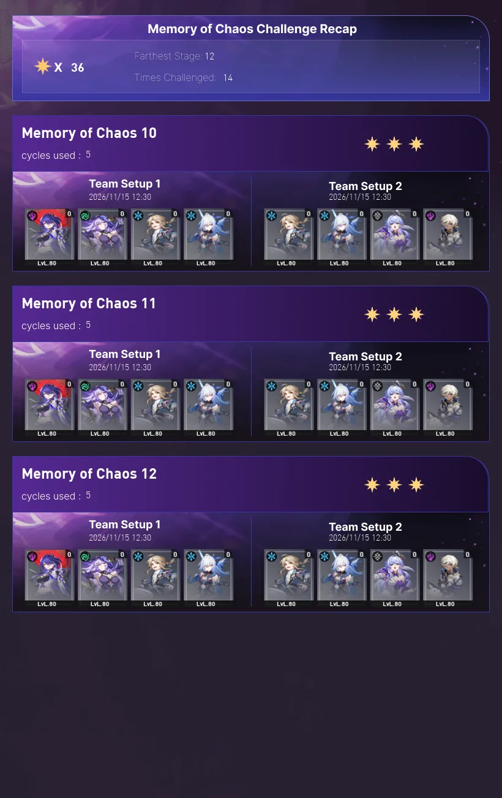](https://raw.githubusercontent.com/MR-LORD-REX/hsr-cards/main/Cards/showcase-moc-sample.png)

```python
image = await client.MOC()
image.save("moc.png")
```

## Pure Fiction record

`HonkaiStarrail.PF` · 820 × 1496

Illustrative output rendered by the public method. Dates, progress, teams and scores are sample values and do not belong to a player account.

**Source:** Fictional documentation sample; cached public artwork

[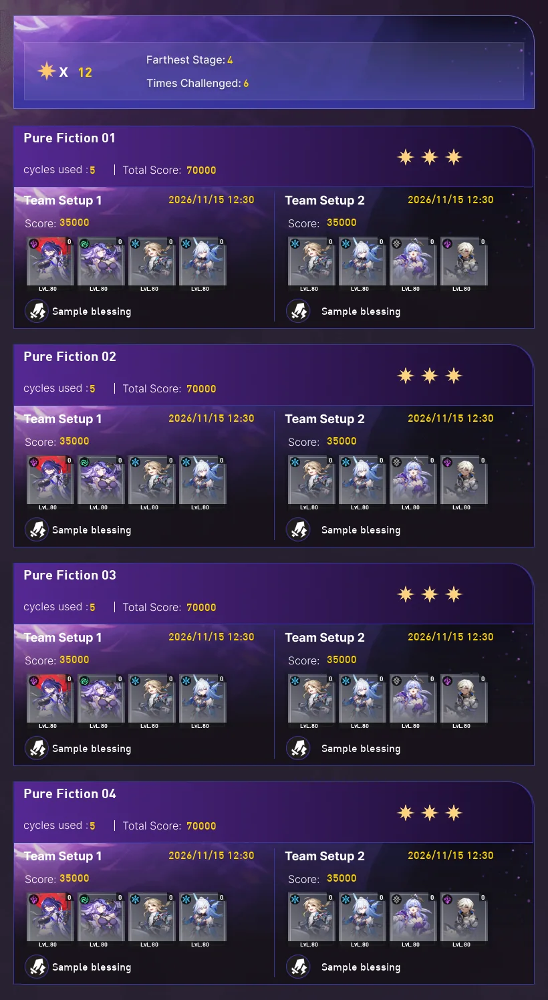](https://raw.githubusercontent.com/MR-LORD-REX/hsr-cards/main/Cards/showcase-pf-sample.png)

```python
image = await client.PF()
image.save("pf.png")
```

## Anomaly Arbitration record

`HonkaiStarrail.anomaly` · 1200 × 1050

Illustrative output rendered by the public method. Dates, progress, teams and scores are sample values and do not belong to a player account.

**Source:** Fictional documentation sample; cached public artwork

[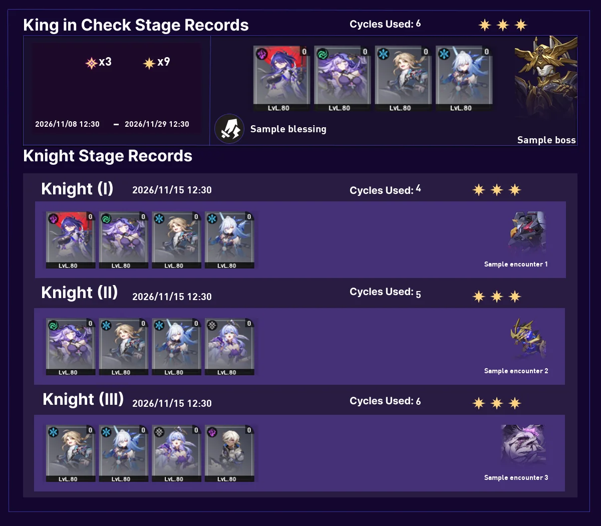](https://raw.githubusercontent.com/MR-LORD-REX/hsr-cards/main/Cards/showcase-anomaly-sample.png)

```python
image = await client.anomaly()
image.save("anomaly.png")
```

## Warp schedule

`HonkaiStarrail.banners` · 533 × 298

Illustrative output rendered by the public method. Dates, progress, teams and scores are sample values and do not belong to a player account.

**Source:** Fictional documentation sample; cached public artwork

[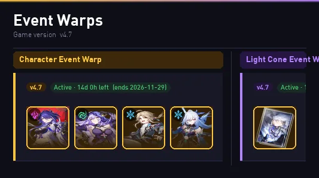](https://raw.githubusercontent.com/MR-LORD-REX/hsr-cards/main/Cards/showcase-banners-sample.png)

```python
image = await client.banners()
image.save("banners.png")
```

## Currency Wars run

`HonkaiStarrail.currency_war` · 720 × 905

Illustrative output rendered by the public method. Dates, progress, teams and scores are sample values and do not belong to a player account.

**Source:** Fictional documentation sample; cached public artwork

[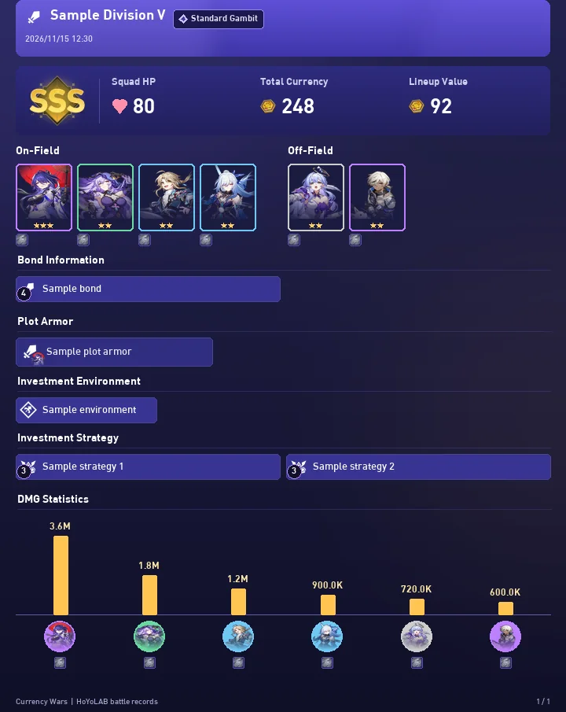](https://raw.githubusercontent.com/MR-LORD-REX/hsr-cards/main/Cards/showcase-currency_war-sample.png)

```python
image = await client.currency_war()
image.image.save("currency-war.png")
```

## Endgame schedule

`HonkaiStarrail.endgame` · 760 × 712

Illustrative output rendered by the public method. Dates, progress, teams and scores are sample values and do not belong to a player account.

**Source:** Fictional documentation sample; cached public artwork

[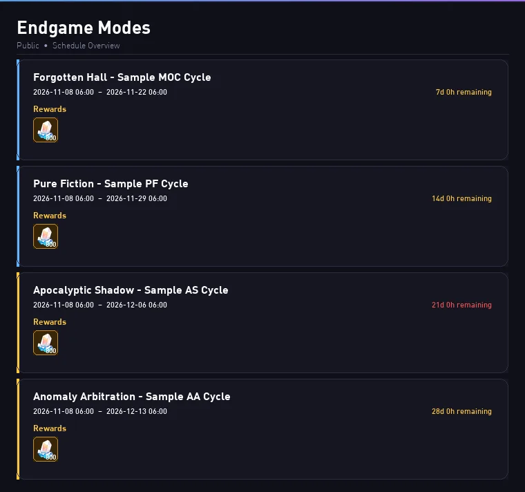](https://raw.githubusercontent.com/MR-LORD-REX/hsr-cards/main/Cards/showcase-endgame-sample.png)

```python
image = await client.endgame()
image.save("endgame.png")
```

## Event calendar

`HonkaiStarrail.events` · 760 × 558

Illustrative output rendered by the public method. Dates, progress, teams and scores are sample values and do not belong to a player account.

**Source:** Fictional documentation sample; cached public artwork

[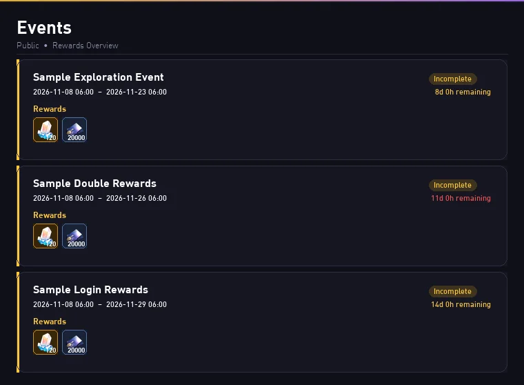](https://raw.githubusercontent.com/MR-LORD-REX/hsr-cards/main/Cards/showcase-events-sample.png)

```python
image = await client.events()
image.save("events.png")
```

## Daily notes

`HonkaiStarrail.notes` · 720 × 344

Illustrative output rendered by the public method. Dates, progress, teams and scores are sample values and do not belong to a player account.

**Source:** Fictional documentation sample; cached public artwork

[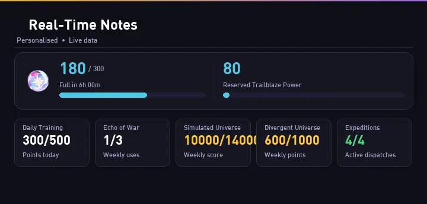](https://raw.githubusercontent.com/MR-LORD-REX/hsr-cards/main/Cards/showcase-notes-sample.png)

```python
image = await client.notes()
image.save("notes.png")
```

## Apocalyptic Shadow record

`HonkaiStarrail.shadow` · 820 × 1308

Illustrative output rendered by the public method. Dates, progress, teams and scores are sample values and do not belong to a player account. The AS sample shows floors 2–4.

**Source:** Fictional documentation sample; cached public artwork

[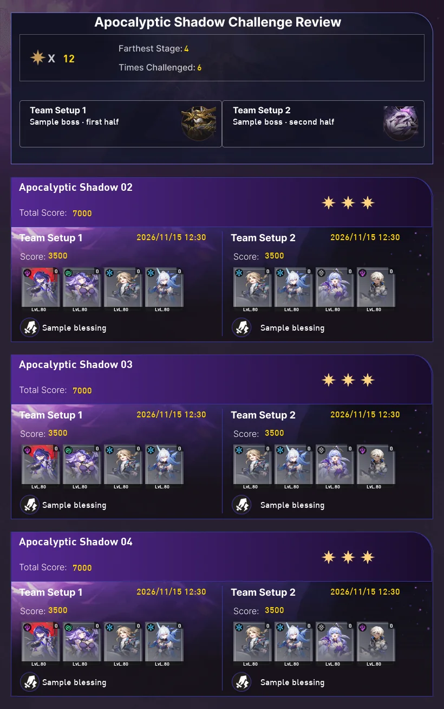](https://raw.githubusercontent.com/MR-LORD-REX/hsr-cards/main/Cards/showcase-shadow-sample.png)

```python
image = await client.shadow()
image.save("shadow.png")
```

## Light Cone information

`HonkaiStarrail.get_LC_info` · 1080 × 1464

Level-80 Light Cone stats with S1–S5 descriptions.

**Source:** Nanoka public catalog; version '4.7.51'

[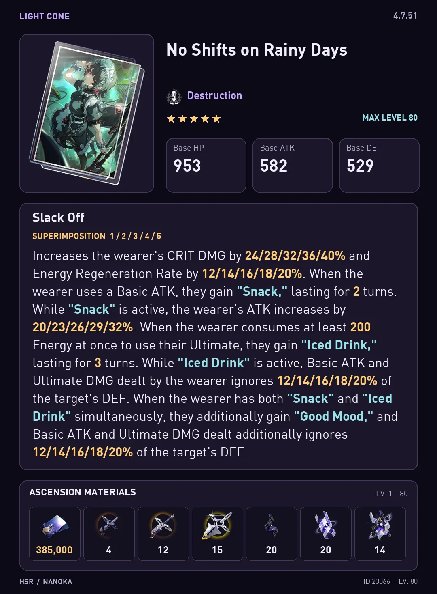](https://raw.githubusercontent.com/MR-LORD-REX/hsr-cards/main/Cards/showcase-get_lc_info-23066.png)

```python
result = await client.get_LC_info(23066, '4.7.51')
result.image.save("get_LC_info.png")
```

<a id="character-info"></a>

## Character information

`HonkaiStarrail.get_character_info` · 1080 × 1440

Character art, ascension materials and level-80 stats.

**Source:** Nanoka public catalog; version '4.7.51'

[](https://raw.githubusercontent.com/MR-LORD-REX/hsr-cards/main/Cards/showcase-get_character_info-blade-mortenax.png)

```python
result = await client.get_character_info(1507, '4.7.51')
result.image.save("get_character_info.png")
```

## Character skills comparison

`HonkaiStarrail.get_character_skills` · 1920 × 3188

Skills, traces and eidolons compared between two public builds.

**Source:** Nanoka public catalog; version ('4.6.51', '4.6.54')

[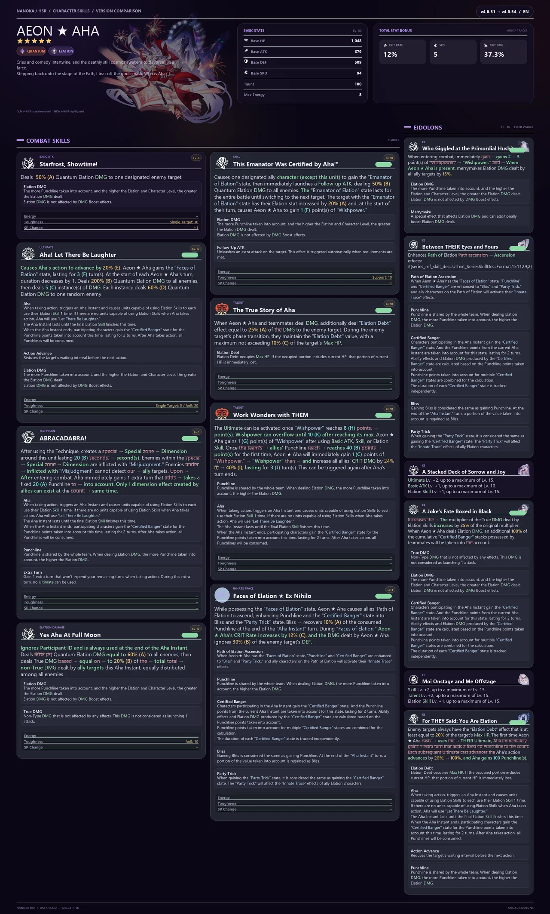](https://raw.githubusercontent.com/MR-LORD-REX/hsr-cards/main/Cards/showcase-get_character_skills-aha-comparison.png)

```python
result = await client.get_character_skills(1511, ('4.6.51', '4.6.54'))
result.image.save("get_character_skills.png")
```

<a id="current-as"></a>

## Current AS · Floor 4

`HonkaiStarrail.get_current_endgame_card` · 1080 × 3333

Enemies, mechanics and buffs for a complete endgame floor. Current/next selection uses the renderer's generation date.

**Source:** Nanoka 4.7.51; season 3021: Dominance of Oblivion

[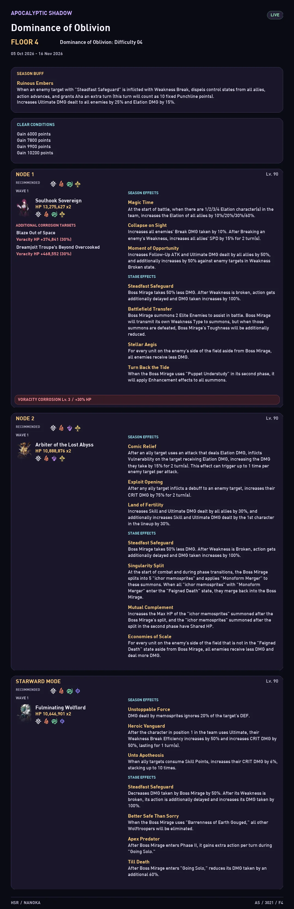](https://raw.githubusercontent.com/MR-LORD-REX/hsr-cards/main/Cards/showcase-get_current_endgame_card-as-floor-4.png)

```python
result = await client.get_current_endgame_card("AS", floors=4)
result.cards[0].image.save("as-floor-4.png")
```

<a id="endgame-current"></a>

## Current MOC · Floor 12

`HonkaiStarrail.get_current_endgame_card` · 1080 × 1860

Enemies, mechanics and buffs for a complete endgame floor. Current/next selection uses the renderer's generation date.

**Source:** Nanoka 4.7.51; season 1036: Survival of the Fittest

[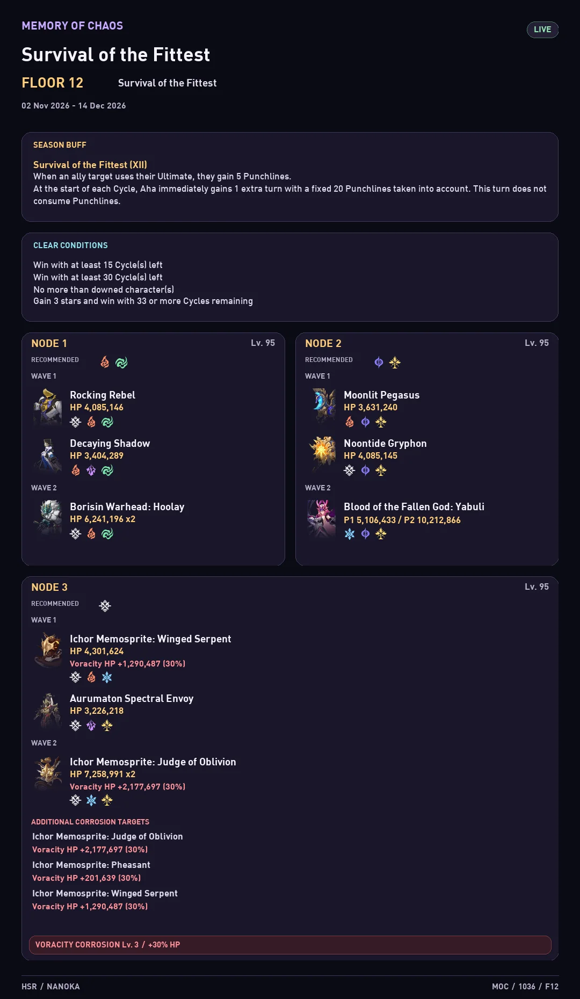](https://raw.githubusercontent.com/MR-LORD-REX/hsr-cards/main/Cards/showcase-get_current_endgame_card-moc-floor-12.png)

```python
result = await client.get_current_endgame_card("MOC", floors=12)
result.cards[0].image.save("moc-floor-12.png")
```

<a id="current-pf"></a>

## Current PF · Floor 4

`HonkaiStarrail.get_current_endgame_card` · 1080 × 3530

Enemies, mechanics and buffs for a complete endgame floor. Current/next selection uses the renderer's generation date.

**Source:** Nanoka 4.7.51; season 2027: Imagined Words

[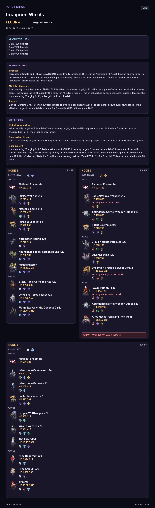](https://raw.githubusercontent.com/MR-LORD-REX/hsr-cards/main/Cards/showcase-get_current_endgame_card-pf-floor-4.png)

```python
result = await client.get_current_endgame_card("PF", floors=4)
result.cards[0].image.save("pf-floor-4.png")
```

## Item information

`HonkaiStarrail.get_item_info` · 1080 × 1350

Public item descriptions and obtain sources.

**Source:** Nanoka public catalog; version '4.7.51'

[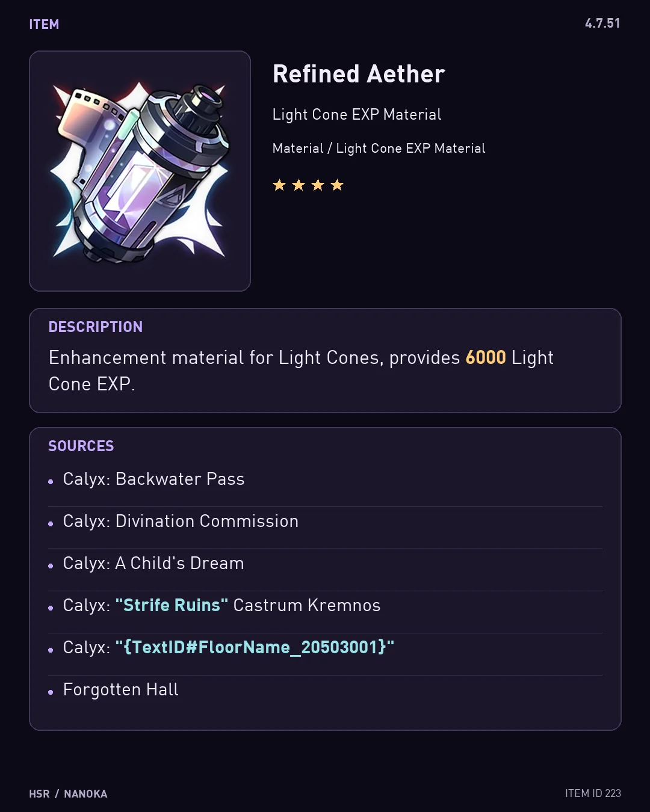](https://raw.githubusercontent.com/MR-LORD-REX/hsr-cards/main/Cards/showcase-get_item_info-223.png)

```python
result = await client.get_item_info(223, '4.7.51')
result.image.save("get_item_info.png")
```

## Next AS · Floor 4

`HonkaiStarrail.get_next_endgame_card` · 1080 × 3195

Enemies, mechanics and buffs for a complete endgame floor. Current/next selection uses the renderer's generation date.

**Source:** Nanoka 4.7.51; season 3022: Navigator's Netherveil

[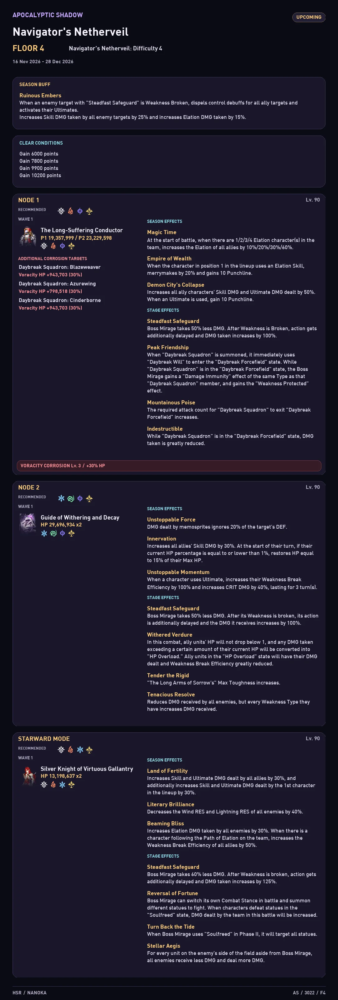](https://raw.githubusercontent.com/MR-LORD-REX/hsr-cards/main/Cards/showcase-get_next_endgame_card-as-floor-4.png)

```python
result = await client.get_next_endgame_card("AS", floors=4)
result.cards[0].image.save("as-floor-4.png")
```

## Next MOC · Floor 12

`HonkaiStarrail.get_next_endgame_card` · 1080 × 1786

Enemies, mechanics and buffs for a complete endgame floor. Current/next selection uses the renderer's generation date.

**Source:** Nanoka 4.7.51; season 1037: Echo of Darkness

[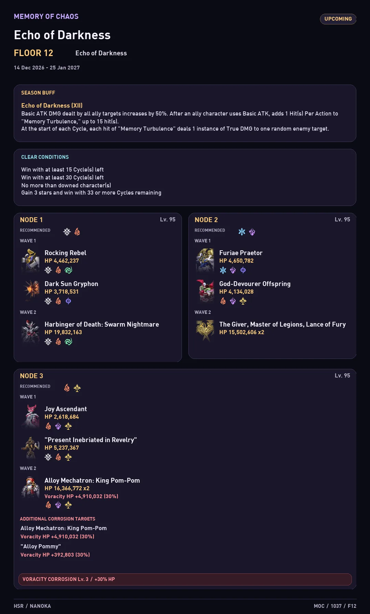](https://raw.githubusercontent.com/MR-LORD-REX/hsr-cards/main/Cards/showcase-get_next_endgame_card-moc-floor-12.png)

```python
result = await client.get_next_endgame_card("MOC", floors=12)
result.cards[0].image.save("moc-floor-12.png")
```

## Next PF · Floor 4

`HonkaiStarrail.get_next_endgame_card` · 1080 × 3441

Enemies, mechanics and buffs for a complete endgame floor. Current/next selection uses the renderer's generation date.

**Source:** Nanoka 4.7.51; season 2028: Fiction Made Truth

[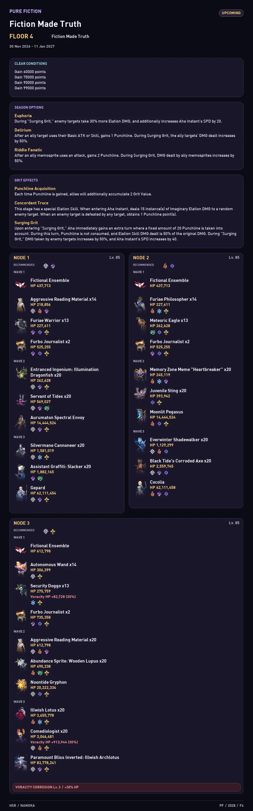](https://raw.githubusercontent.com/MR-LORD-REX/hsr-cards/main/Cards/showcase-get_next_endgame_card-pf-floor-4.png)

```python
result = await client.get_next_endgame_card("PF", floors=4)
result.cards[0].image.save("pf-floor-4.png")
```

## Relic set information

`HonkaiStarrail.get_relic_info` · 1080 × 1350

Relic pieces, artwork and set bonuses.

**Source:** Nanoka public catalog; version '4.7.51'

[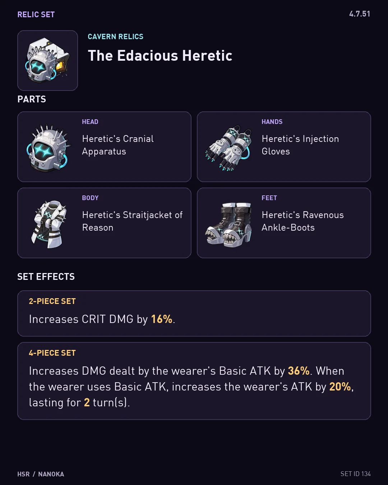](https://raw.githubusercontent.com/MR-LORD-REX/hsr-cards/main/Cards/showcase-get_relic_info-134.png)

```python
result = await client.get_relic_info(134, '4.7.51')
result.image.save("get_relic_info.png")
```

## Batch information rendering

`HonkaiStarrail.render_all_info` · 1080 × 1440

One successful card from the batch result. Each character retains its own outcome and error.

**Source:** Nanoka 4.7.51; a one-character batch

[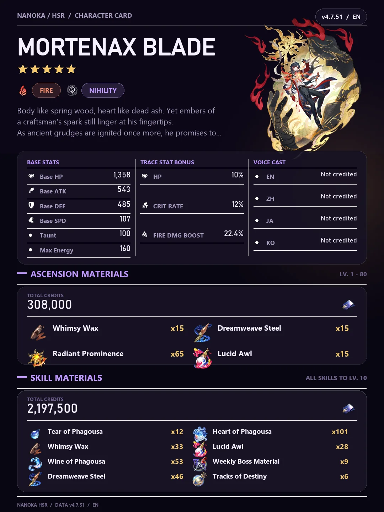](https://raw.githubusercontent.com/MR-LORD-REX/hsr-cards/main/Cards/showcase-render_all_info-blade-mortenax.png)

```python
batch = await client.render_all_info("4.7.51", identifiers=[1507])
for item in batch.succeeded:
    item.image.save(f"{item.identifier}.png")
```

## Batch skills rendering

`HonkaiStarrail.render_all_skills` · 1920 × 1838

One successful card from the batch result. Each character retains its own outcome and error.

**Source:** Nanoka 4.7.51; a one-character batch

[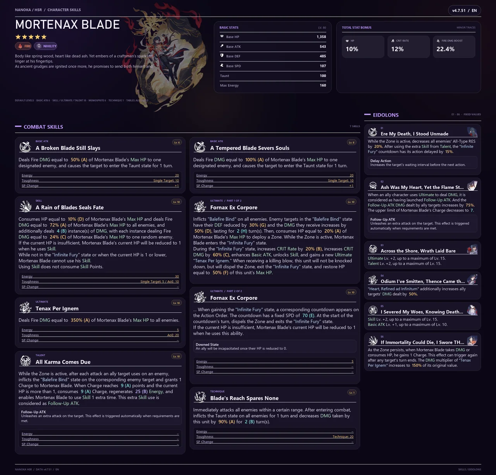](https://raw.githubusercontent.com/MR-LORD-REX/hsr-cards/main/Cards/showcase-render_all_skills-blade-mortenax.png)

```python
batch = await client.render_all_skills("4.7.51", identifiers=[1507])
for item in batch.succeeded:
    item.image.save(f"{item.identifier}.png")
```

## Acheron build · Clean

`HonkaiStarrail.character_build` · 1920 × 1440

The public method returns an approved build image. Detailed mode also returns the available condition pages; this preview shows the summary.

**Source:** Packaged, approved Prydwen build assets; retrieved through the public facade

[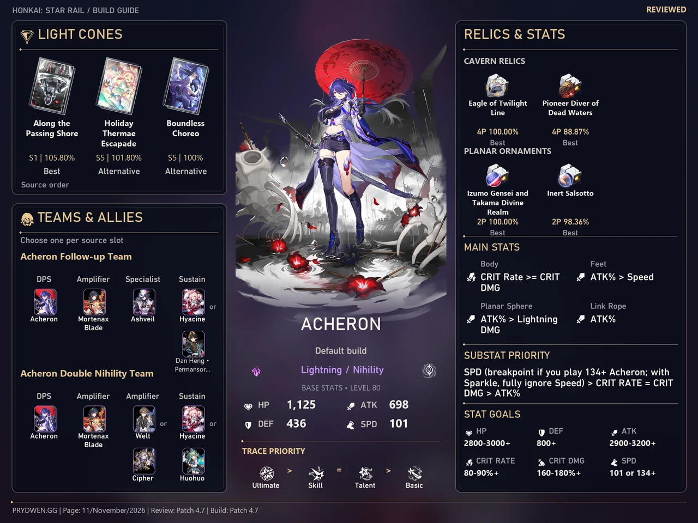](https://raw.githubusercontent.com/MR-LORD-REX/hsr-cards/main/Cards/showcase-character_build-acheron-clean.png)

```python
build = await client.character_build("Acheron", detailed=False)
build.save("acheron.png")
```

## Acheron build · Detailed

`HonkaiStarrail.character_build` · 1920 × 1440

The public method returns an approved build image. Detailed mode also returns the available condition pages; this preview shows the summary.

**Source:** Packaged, approved Prydwen build assets; retrieved through the public facade

[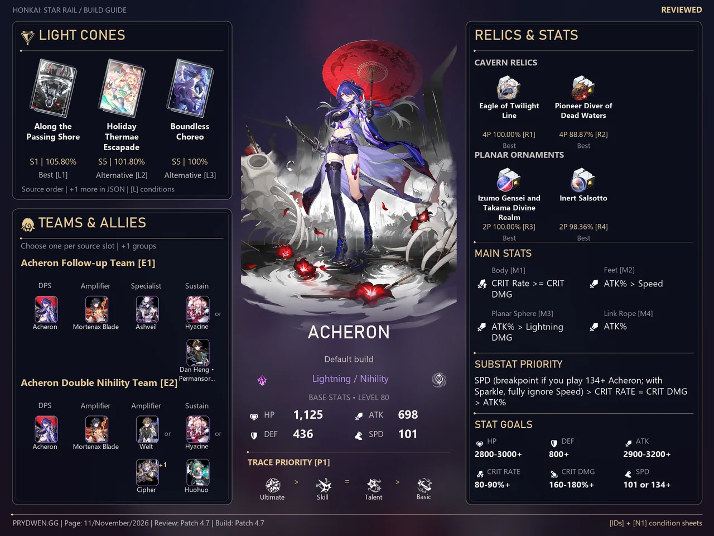](https://raw.githubusercontent.com/MR-LORD-REX/hsr-cards/main/Cards/showcase-character_build-acheron-detailed.png)

```python
build = await client.character_build("Acheron", detailed=True)
build[0].save("acheron-detailed.png")
```

## Apocalyptic Shadow tier list

`HonkaiStarrail.tier_list` · 1280 × 4836

Fresh public tier-list snapshot with role columns, character tags and ranking-change marks. Rankings can change after this documentation image was generated.

**Source:** Public Prydwen AS tier list fetched 2026-11-15; source update: 11/November/2026

[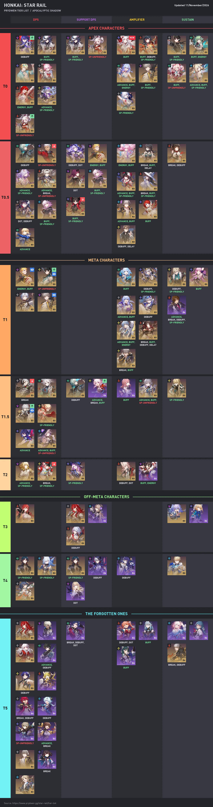](https://raw.githubusercontent.com/MR-LORD-REX/hsr-cards/main/Cards/showcase-tier_list-as-snapshot.png)

```python
image = await client.tier_list("AS")
image.save("as-tier-list.png")
```

<a id="tier-list-moc"></a>

## Memory of Chaos tier list

`HonkaiStarrail.tier_list` · 1280 × 4417

Fresh public tier-list snapshot with role columns, character tags and ranking-change marks. Rankings can change after this documentation image was generated.

**Source:** Public Prydwen MOC tier list fetched 2026-11-15; source update: 11/November/2026

[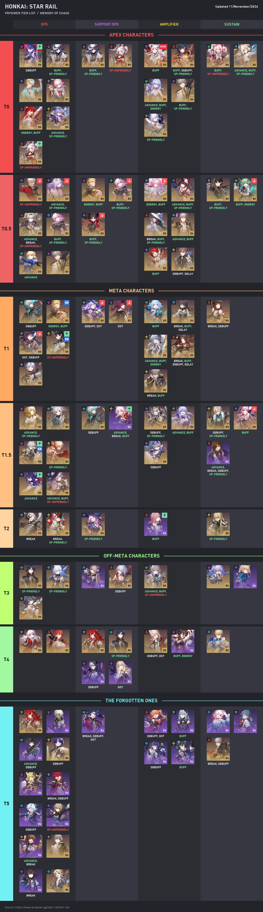](https://raw.githubusercontent.com/MR-LORD-REX/hsr-cards/main/Cards/showcase-tier_list-moc-snapshot.png)

```python
image = await client.tier_list("MOC")
image.save("moc-tier-list.png")
```

## Pure Fiction tier list

`HonkaiStarrail.tier_list` · 1280 × 4870

Fresh public tier-list snapshot with role columns, character tags and ranking-change marks. Rankings can change after this documentation image was generated.

**Source:** Public Prydwen PF tier list fetched 2026-11-15; source update: 11/November/2026

[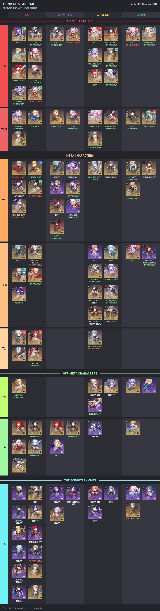](https://raw.githubusercontent.com/MR-LORD-REX/hsr-cards/main/Cards/showcase-tier_list-pf-snapshot.png)

```python
image = await client.tier_list("PF")
image.save("pf-tier-list.png")
```

<a id="build-card"></a>

## Prydwen single build rendering

`PrydwenClient.card` · 1920 × 1440

Fresh rendering of a cached source snapshot through the standalone build pipeline. Draft status is retained and the render uses Nanoka artwork.

**Source:** Cached public Prydwen Acheron HTML, parsed as a draft; no approval or publication

[](https://raw.githubusercontent.com/MR-LORD-REX/hsr-cards/main/Cards/showcase-prydwen-card-acheron-draft.png)

```python
with_data = client.parse("acheron")
path = client.card("acheron", allow_draft=True)
```

## Prydwen batch build rendering

`PrydwenClient.cards` · 1920 × 1440

Fresh rendering of a cached source snapshot through the standalone build pipeline. Draft status is retained and the render uses Nanoka artwork.

**Source:** Cached public Prydwen Acheron HTML, parsed as a draft; no approval or publication

[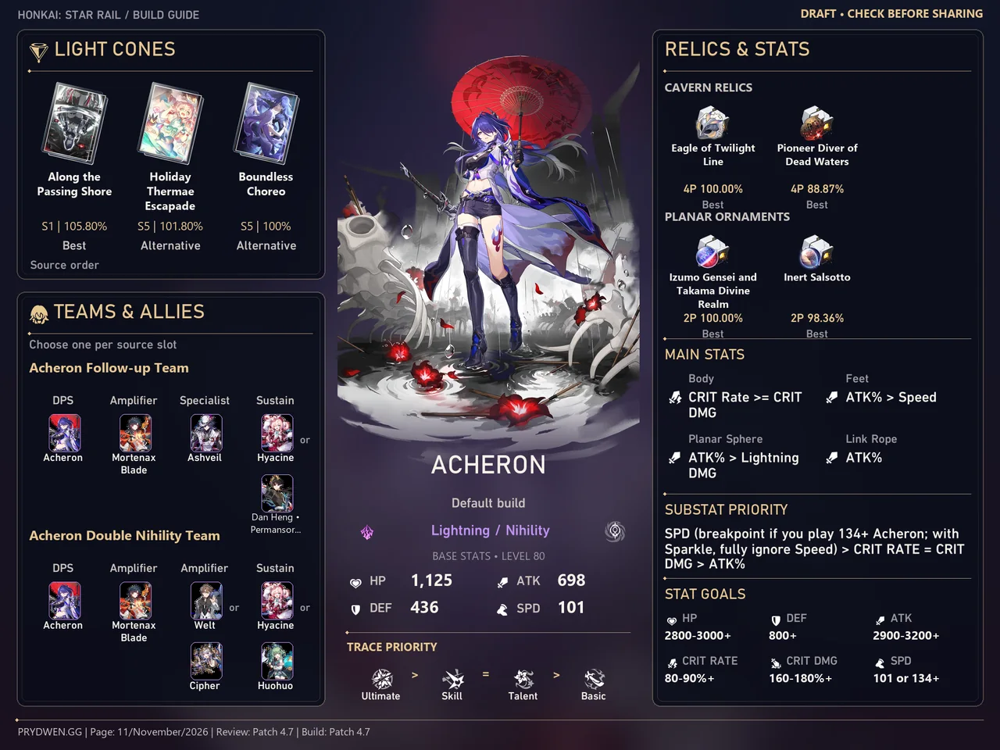](https://raw.githubusercontent.com/MR-LORD-REX/hsr-cards/main/Cards/showcase-prydwen-cards-acheron-draft.png)

```python
with_data = client.parse("acheron")
result = client.cards(["acheron"], allow_draft=True)
```

## Methods without image output

Provider queries, verification, cache updates, parsing, approval, validation, lifecycle methods and properties return data or manage resources. Their usage is documented in the API guides. AA Nanoka floor cards remain deferred; the supported player `anomaly()` card is shown above.
